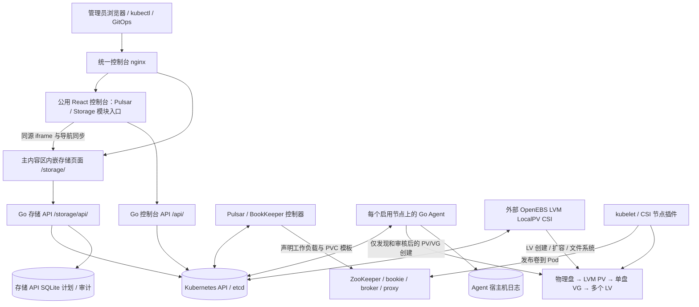
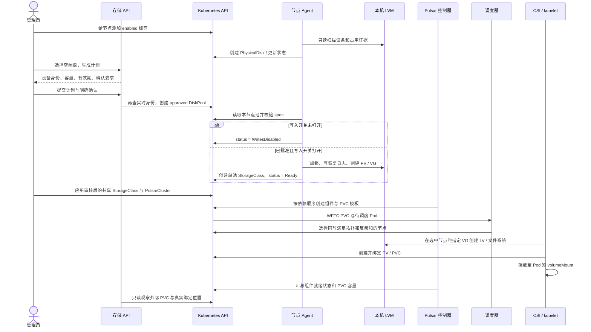
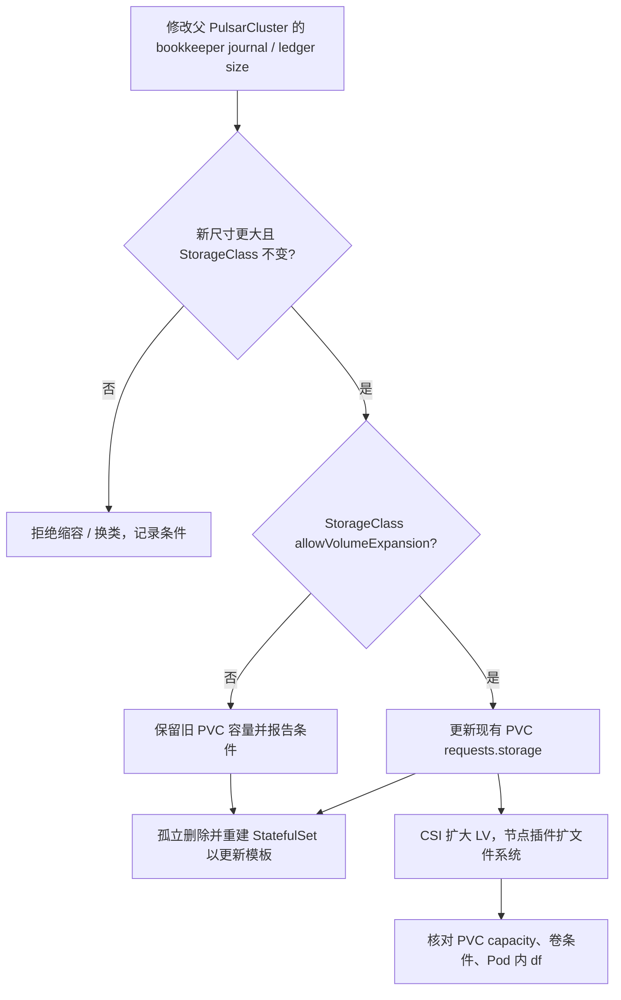
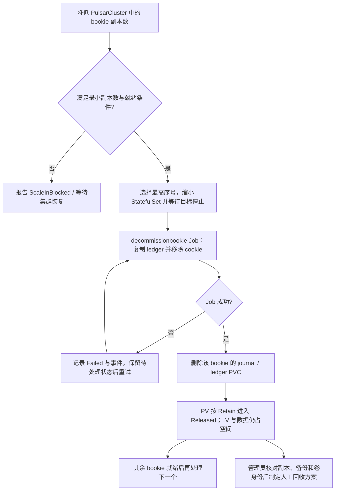

# 架构设计

本文描述统一仓库 `pulsar-operator` 的实际实现，以及它管理物理盘、为 Pulsar 分配本地持久卷的方式。操作步骤见 [使用指南](../operations/deployment.md)，代码与构建组织见 [项目设计](repository.md)。

## 1. 产品边界与设计目标

系统按 Pulsar、Storage、Agent 三个项目模块组织：Pulsar Operator 管理消息服务生命周期；Storage 提供存储管理 API 与资源契约；Go Agent 管理节点物理盘清单与 LVM 卷组。外部 OpenEBS LVM LocalPV CSI 将卷组空间按 PVC 请求分配为逻辑卷，并负责文件系统和挂载。

“动态划分物理盘为 PV”在本项目中的含义是：**一块审核通过的物理盘对应一个 LVM PV/VG，多个 Kubernetes PVC 在该 VG 上获得独立 LV，由 CSI 创建对应的 Kubernetes PV**。这里 LVM PV 是物理卷，Kubernetes PV 是集群对象，两者不是同一种资源。实现没有使用分区表反复切分物理盘，也没有把宿主机目录当作有容量隔离的真实磁盘。

| 目标 | 当前实现 | 边界 |
| --- | --- | --- |
| 统一交付 Pulsar 与物理存储管理 | 同一仓库、统一构建入口、聚合部署与浏览器入口 | Pulsar、Storage API、Go Agent 的进程、权限和镜像独立 |
| 发现大批节点的物理盘 | 每节点 Agent、不可变身份清单、分页接口、批量审核计划 | 尚无万节点/万盘真实集群性能验收 |
| 按需分配和扩容本地卷 | LVM VG + 外部 CSI + PVC | 不实现自己的 CSI 驱动；本地卷不能自动跨节点漂移 |
| 保护已有磁盘数据 | 只接管空闲盘、双重写入开关、持久化操作日志、默认 Retain | 不自动擦盘、回收 LV、迁移坏盘或导入既有 VG |
| Pulsar 真实资源模型集成 | 上游 CRD/控制器、共享 StorageClass 生成器、外部 PVC 只读展示、E2E 脚本 | 两节点共享数据盘实验已通过真实 E2E；三节点物理分离与故障验收仍待执行，见[验证记录](../history/validation.md) |

## 2. 系统结构



图中的组件箭头表示控制关系；业务消息不会经过存储 API、统一入口或 Agent。消息写入路径为客户端 → broker → bookie → 已挂载文件系统 → LV → 物理盘。

### 模块职责

| 模块 / 位置 | 负责 | 不负责 |
| --- | --- | --- |
| `api/storage/v1alpha1` | `PhysicalDisk`、`DiskPool` 与设备身份的共享类型；Storage 与 Agent 共用 | HTTP 路由与节点操作执行 |
| `api/pulsar/v1alpha1` | `PulsarCluster`、`BookKeeperCluster` 的期望状态与观测状态 | 物理盘初始化 |
| `internal/pulsar/controller` | 集群依赖顺序、配置与镜像滚动、PVC 扩容、bookie 下线 | LV 分配、文件系统挂载 |
| `internal/pulsar/resources` | StatefulSet、Deployment、Service、Job、ConfigMap 等资源构造 | 执行宿主机命令 |
| `internal/pulsar/httpapi`、`web` | 统一 React 布局、Broker/Bookie 独立管理视图、资源关联、Pulsar API 与监控 | 改变子 BookKeeper 的控制器所有权，接管存储模块的写权限 |
| `internal/pulsar/metrics` | 查询 Prometheus 并组织控制台指标 | 物理盘 SMART、固件、RAID 运维 |
| `internal/agent/discovery`、`internal/agent/lvm` | 设备发现、身份核验、受控 PV/VG 初始化、崩溃恢复日志 | 格式化 LV、挂载业务卷 |
| `cmd/agent`、`internal/agent` | 每节点 CR 调谐、状态上报、单池 StorageClass | 跨节点存储数据复制 |
| `internal/storage/cluster` | 真实集群管理 API 后端、计划执行、PVC 所有权检查 | 修改 Pulsar 的 PVC 或父 CR |
| `internal/storage/fleet` | 审核后的多节点 StorageClass 与 Pulsar 集成清单生成 | 自动维护动态池组 CRD |
| `internal/storage/store` | 演示模型、计划、操作历史 | 作为生产 PV/PVC 状态的事实来源 |
| `deploy/components/console-gateway` | 两个 UI/API 的路径路由 | 自动授予权限、合并令牌、SSO |
| OpenEBS LVM LocalPV CSI（外部） | Kubernetes PV、LV、卷扩容、文件系统、挂载 | Pulsar ledger 复制与 bookie 下线 |

## 3. 资源模型、版本与所有权

### Kubernetes API

| 资源 | API / 范围 | 期望状态由谁写 | 状态或实际资源由谁维护 |
| --- | --- | --- | --- |
| `PulsarCluster` | `pulsar.songof.dev/v1alpha1`，命名空间级 | 管理员 / Pulsar 控制台 / GitOps | Pulsar 控制器 |
| `BookKeeperCluster` | `pulsar.songof.dev/v1alpha1`，命名空间级 | 父 Pulsar 控制器；独立部署时由管理员 | BookKeeper 控制器 |
| `PhysicalDisk` | `storage.diskfleet.io/v1alpha1`，集群级 | 节点 Agent 创建不可变身份清单 | 同节点 Agent 更新 `status` |
| `DiskPool` | `storage.diskfleet.io/v1alpha1`，集群级 | 管理员 / 存储 API，需显式批准 | 同节点 Agent 更新 `status`、保护 finalizer |
| 单池 `StorageClass` | `storage.k8s.io/v1`，集群级 | Agent 创建 | 已有内容不符时拒绝覆盖 |
| 多节点共享 `StorageClass` | `storage.k8s.io/v1`，集群级 | 生成器产出，管理员审核应用 | 当前为显式快照，无自动池组控制器 |
| Pulsar PVC | `v1`，命名空间级 | StatefulSet / Pulsar 控制器 | Kubernetes 与 CSI；存储 UI 仅观察 |
| DiskFleet 自建 PVC | `v1`，命名空间级 | 存储 API | Kubernetes 与 CSI；存储 API 可扩容、释放 |
| Kubernetes PV | `v1`，集群级 | CSI provisioner | CSI、PV 控制器 |
| 宿主机 VG | LVM 元数据 | DiskFleet Agent | Agent 核验；CSI 使用其空闲空间 |
| LV / 文件系统 / 挂载 | LVM / Linux | CSI | CSI / kubelet |

两个自定义 API 均为 `v1alpha1`，尚无多版本 conversion webhook。产品重命名为 `pulsar-operator` 不改写既有 API group、CR 名称、标签或 finalizer；不能通过删 CRD 后重装来“迁移”已有数据。

`PhysicalDisk.spec` 记录节点、稳定设备路径、序列号、精确字节容量、型号与介质类型。`DiskPool.spec` 指定 `nodeName`、`devices[{path,serial,sizeBytes}]`、`vgName` 和 `approved`。身份字段不可变，设备同名但序列号或容量变化不能自动继承旧池。

节点对象名与 `kubernetes.io/hostname` 不一定相同。Agent 用 `spec.nodeName` 判断执行位置，从真实 Node 标签获取 CSI 拓扑。对象的节点筛选标签值超过 63 字符时使用稳定哈希，写操作仍重新核对完整 `spec.nodeName`。

同一节点的设备路径、序列号或 VG 不允许被多个 DiskPool 声明。Agent 与接管 API 对实时 DiskPool 清单做冲突检查；宿主所有权日志绑定 DiskPool UID，阻止删除重建 CR 后冒认原卷组。旧版 Ready 日志只有在池唯一、StorageClass UID/参数/拓扑和实际 LVM UUID/标签/单盘成员全部吻合时才能补记 UID；中间状态或证据不全时停止并要求人工核查。

### PVC 生命周期所有权

存储 API 可以观察使用可信单池/共享 StorageClass 的 Pulsar PVC；它同时验证驱动、精确 VG 规则、池 UID、拓扑、Retain、WFFC 和扩容设置，避免仅凭类名推断归属。

观察到的外部 PVC 返回 `management=external`、`canManage=false`。可写 PVC 必须同时满足：

1. 标签 `storage.diskfleet.io/managed=true`。
2. 不含 `ownerReferences`。
3. `app.kubernetes.io/managed-by` 为空或 `diskfleet`。

Pulsar 保留的 PVC 可能没有 `ownerReferences`，但仍带 `app.kubernetes.io/managed-by=pulsar-operator`，因此不会被存储 API 接管。Pulsar 的容量变更应修改父 `PulsarCluster.spec`；直接编辑子 PVC 容易被控制器重新收敛。

Bound PVC 的归属以实际 PV 为依据：校验 claimRef UID、CSI 驱动、卷组和节点亲和性，再关联可信池。Retain 重新绑定缺少 selected-node 注解时仍可解析；证据不匹配则返回 `bindingVerified=false` 和原因，禁止写操作，不猜测所属节点。

Go 控制器只修改 controller ownerReference 指向当前 CR UID 的既有资源，不接管同名无主 BookKeeperCluster、StatefulSet 或辅助组件。删除使用 UID/resourceVersion 前提。控制台也要求客户端提交读到的 UID/version；PATCH 的身份测试与 spec 变更由 Kubernetes 原子执行，避免读写间替换对象的竞态。

## 4. 物理盘如何接入系统与 Pod

接线、HBA/RAID 配置和操作系统识别是前置条件。管理员将 SATA/SAS/NVMe 设备安装到物理服务器，确认控制器和 Linux 驱动能识别设备。该项目不管理 BMC、不刷固件、不创建硬件 RAID，也不建立 iSCSI/FC 会话。多路径、已有 RAID/LVM/文件系统等复杂场景不能当作空白单盘自动接管。

从 Linux 块设备到业务目录分为以下层次：

```text
物理盘 / 控制器 / 驱动
  └─ Linux 块设备，优先使用 /dev/disk/by-id/... 稳定标识
      └─ DiskFleet：只读发现 → 审核身份 → pvcreate → 单盘 vgcreate
          └─ OpenEBS CSI：按 PVC 创建 LV → ext4 → CSI 卷发布
              └─ kubelet：把卷挂载到 Pod 声明的 volumeMount
                  ├─ ZooKeeper：/pulsar/data/zookeeper
                  ├─ bookie journal：/pulsar/data/bookkeeper/journal
                  └─ bookie ledgers：/pulsar/data/bookkeeper/ledgers
```

管理员不需要把整盘先 `mkfs`、写 `/etc/fstab` 或手工挂到 `/mnt`。那会产生已有文件系统/挂载证据，盘应被保护，且与 CSI 的卷生命周期冲突。Pod 挂载位置来自工作负载规范；宿主机 CSI staging/publish 目录由 kubelet/插件维护，不作为稳定业务接口。

Agent 使用 `lsblk`、设备标识、挂载信息、swap 和 sysfs holders 等证据判定可用性；会检查子设备挂载以及当前进程和宿主 PID 1 的挂载信息。已有分区/签名、只读盘、系统盘占用、swap、holders、身份不完整或证据缺失均进入保护状态。loop 设备不作为待初始化物理盘。发现是只读操作，节点启用标签只授权部署 Agent，不等于授权写盘。

稳定路径优先选择硬件 WWN，其他物理 by-id 按名称确定；排除 `lvm-pv-uuid-*` 元数据别名，避免 `pvcreate` 后更换已批准的 virtio/WWN 身份。Agent 只读挂载宿主机 `/run/udev`，让容器内 `lsblk` 能读取设备序列号。该路径选择不放宽序列号、容量、签名、挂载或 holders 检查。

实际初始化需要同时满足节点已启用、DiskPool 设备身份匹配、`approved: true`、Agent `ENABLE_DISK_WRITES=true`。LVM 后端使用固定参数数组执行命令，持有本机互斥锁，并在宿主机保存 fsync/原子替换的 JSON 日志。日志包含设备身份、预先生成的 PV UUID 与 VG 所有权信息，用于恢复 `pvcreate`/`vgcreate` 与日志提交之间的崩溃窗口。没有受信任记录的既有 PV/VG 不会被接管，已管理 VG 消失也不会被自动重新格式化。

## 5. 从物理盘到 Pulsar PVC 的创建时序



Pulsar 启动依赖链为 ZooKeeper → BookKeeper 元数据初始化 → bookie → Pulsar 元数据初始化 → broker → proxy。存储池 `Ready` 只表示 VG 和存储类准备完毕；PVC `Bound` 只表示卷绑定完成；必须继续检查 Pod 挂载、权限、应用就绪与消息读写，才能认定业务可用。

## 6. 多节点分配与故障域

单池 StorageClass 用精确 `vgpattern=^df_...$` 和单个 hostname 限定节点，适合明确放置的独立卷。把它直接用于三个要求分散部署的 bookie，会让所有副本争用一个节点，与 Required 反亲和冲突。

共享类生成器为 ZooKeeper、journal、ledger 分别产出跨节点 StorageClass：VG 名称是审核集合的精确正则并集，hostname 是对应集合，注解记录 `{poolName: poolUID}`。三个角色覆盖相同节点集合，每角色每节点一个池。默认 `three-node-e2e` 和 `two-node-lab` 要求 journal 与 ledger 使用不同物理池；生成前检查重名 VG 是否可能误选其他角色或未审核的池。

默认验收规划至少三个节点、三个副本；采用 Required hostname 反亲和。默认验收申请每节点 ZooKeeper 5 GiB、journal 5 GiB、ledger 20 GiB，并为 ledger 扩容与保留探针额外预留 2 GiB。ZooKeeper 可以共享 journal 的 VG，但容量检查会累加两者请求。这是验收参数，不是生产容量推荐值。

| 规划 profile | 节点与物理池规则 | 反亲和与验收入口 |
| --- | --- | --- |
| `three-node-e2e`（默认） | 至少三节点；每节点 journal/ledger 分盘 | Required；原三节点 E2E |
| `two-node-lab` | 恰好两节点；仍要求 journal/ledger 分盘 | Preferred；两节点实验 |
| `two-node-shared-disk-lab` | 恰好两节点、每节点一块独立数据盘；三个角色使用同一组两个池 | Preferred；独立共享盘 E2E |

本次 `.149/.150` 使用显式的 `two-node-shared-disk-lab`，两块已授权的 100 GiB 数据盘各建一个 VG，三个角色获得独立 LV/PVC。此 profile 有独立标签、StorageClass 和验收入口，不修改默认三节点分盘规则。Preferred 允许副本同机，因此每个池预检至少 94 GiB 实际空闲容量，覆盖全部 90 GiB 初始业务卷、3 GiB ledger 扩容与 1 GiB Retain 探针的最坏放置。三个角色共盘没有物理盘或 I/O 隔离，两节点实验也不保证主机故障高可用。配置见[共享数据盘指南](../labs/shared-data-disk.md)，实际结果见[验证记录](../history/validation.md)。

共享类是一次审核的配置快照。新池加入不会自动改变既有类，也不自动迁移已有卷。Pulsar 当前拒绝给已有卷切换 StorageClass，因此扩展节点覆盖范围需要预先设计类的生命周期或单独的数据迁移方案，不能把“重新生成文件”当作迁移完成。

WFFC 把初次卷创建延迟到有消费 Pod 时，协调多 PVC 的拓扑交集。绑定后本地 PV 仍固定到原节点：重建 Pod 可以回到该节点复用数据，节点不可用时不能把 LV 自动挂到另一节点。BookKeeper 的副本恢复负责应用层数据冗余，不能替代存储故障排查。当前未将机架标签写入 BookKeeper rack 信息，hostname 分散不等于跨机架容灾。

## 7. 扩容流程



孤立删除 StatefulSet 用于处理 PVC 模板不可原地修改的约束，保留现有 Pod/PVC；它不是删数据后重建卷。CSI 或文件系统扩容尚未完成时，PVC 请求量可能大于实际容量，UI 应持续显示进行中的状态。VG 容量不足、CSI 不支持或节点不可用都可能使扩容停滞。

独立的 DiskFleet 自建 PVC 由存储 API 修改容量；Pulsar 的 bookie PVC 从父 CR 调整。两条路径最终都依赖 CSI，单纯 API 请求成功不代表文件系统已增长。

此处已实现的父 CR 在线扩容路径限定于 BookKeeper journal/ledger。ZooKeeper 和监控资源的现有卷大小或 StorageClass 变更被明确拒绝，并报告条件；Prometheus 的容量保留阈值也不会跟随未实现的扩容增长。

## 8. Bookie 下线、删除与数据保留

下线先把目标 ordinal、Bookie ID 和两个 PVC 的 UID 写入 `status.decommission`，写入成功后才缩小 StatefulSet；状态冲突时不停止任何新的 Bookie。孤立重建 StatefulSet 时优先恢复该阶段，不直接采用最终目标副本数。复制 Job 成功后，先持久化 Cleaning 阶段，再按已记录 UID 删除 PVC，等待 PVC/Job 实际消失后才清除阶段并处理下一副本。旧版本中途操作如果缺少 PVC UID 记录会停止并报告错误，需要人工核对并恢复状态；不会猜测同名卷的身份。

模板扩容需要孤立重建时，额外先把安全副本数和存储布局写入 `status.recreation`。即使本轮因不健康或最小副本限制而未启动下线，下一轮也先按该记录恢复 StatefulSet，再验证最新 spec。这样删除窗口中的再次缩容、缩盘或清空 StorageClass 不会绕过已有模板校验。PVC 扩容还会核验标签、所有者和当前受管 Bookie Pod 的引用，并带版本条件提交。



三个保留策略作用于不同层次，不能互相替代：

| 操作 / 设置 | 对象结果 | 数据结果 |
| --- | --- | --- |
| 删除 BookKeeperCluster，`storage.reclaimPolicy=Retain` | 保留 bookie PVC | PVC 仍占用 PV/LV |
| 删除 BookKeeperCluster，`storage.reclaimPolicy=Delete` | 控制器删除 bookie PVC | 后续由实际 PV reclaimPolicy 决定 |
| 正常 decommission 一个 bookie | 完成副本恢复后始终删除其 journal/ledger PVC，不受上述 CR 字段控制 | DiskFleet 创建的 Retain PV/LV 留存 |
| 删除绑定 Retain PV 的 PVC | PVC 删除，PV 进入 Released | LV 保留，VG 可用量不会立即增加 |
| 删除 DiskPool | `retain-media` finalizer 阻止正常删除，状态为 Retained | 不执行 `lvremove` / `vgremove` / `pvremove` |

Released 不是可直接分配给下一位用户的干净卷。Retain 提供人工恢复窗口，也带来存储占用；它不是备份，更不能抵御物理盘损坏。移除 DiskPool finalizer 只是在管理员审核后删除 Kubernetes 对象，不等于执行物理数据回收。本项目未提供自动擦除、回收审批或安全复用流程。

## 9. 统一控制台与 API

### 工作空间与组件管理

根目录 `web/` 保持公用前端。`ConsoleShell.jsx` 提供侧栏、顶栏和模块路由，一级入口为 Pulsar、Storage，各自显示子页面导航。`PulsarWorkspace.jsx` 管理 Pulsar 总览、Broker / Bookie、凭证和 API 轮询；`StorageWorkspace.jsx` 管理存储嵌入页面。切换到 Storage 后卸载 Pulsar 工作区，停止其轮询并丢弃过期响应；直接进入 Storage 不请求 Pulsar API。前端 hash 路由用于刷新和双向跳转，不新增 Kubernetes 资源种类。

| 入口 / 路由 | 展示与操作范围 | 资源写入目标 |
| --- | --- | --- |
| Pulsar 总览 `/#/pulsar/overview` | 组件数量、Pulsar 与 BookKeeper 关联表、异常关系 | 通过具体组件管理入口操作 |
| Pulsar → Broker `/#/pulsar/brokers/{namespace}/{name}` | Broker、ZooKeeper、Proxy 的状态、配置、升级、Pod/事件；关联 BookKeeper 跳转 | `PulsarCluster.spec` 中对应组件；集群级删除也在此处明确执行 |
| Pulsar → Bookie `/#/pulsar/bookies/{namespace}/{name}` | 所有 BookKeeper，包括受管子资源与独立部署；bookie/autorecovery、Journal/Ledger、扩容与下线 | 受管资源写父 `PulsarCluster.spec.bookkeeper`；独立资源写自身 `BookKeeperCluster.spec` |
| Storage `/#/storage/{page}` | 七个存储页面及原有计划、卷管理能力 | 存储 API 仍执行原有设备批准与 PVC 所有权规则 |

Broker、Bookie 的列表入口分别为 `/#/pulsar/brokers` 和 `/#/pulsar/bookies`。旧 `/#/overview`、`/#/brokers/...`、`/#/bookies/...` 链接会保留资源身份并替换为新路径，不额外插入浏览器历史记录。

Broker 和 Bookie 在列表、详情页及指标展示上独立管理。受管 Bookie 页面读取子 BKC 的状态、Pod 和事件，修改副本、镜像、配置、容量时把期望值写回父 PulsarCluster；父控制器再更新子 BKC。监控复用父集群的 Prometheus 配置并展示 Bookie 指标。受管子资源不能从 Bookie 页面直接删除；孤立或身份失配的对象只读。这样既能独立操作组件，又避免直接改子资源后被父控制器覆盖。

“关联”必须由同 namespace 的唯一控制器 ownerReference 证明：API group 为 `pulsar.songof.dev`、kind 为 `PulsarCluster`、`controller=true`、父名称和 UID 与当前父资源一致。当前控制器只创建与父同名的 canonical 子 BKC，因此同名约束也需要满足；仅名字相似或同一个 instance 标签不能建立关系。父资源尚未创建子 BKC 时显示等待关联；存在所有权证据但无法验证时显示关联异常，不能降级为可写的独立集群。页面支持 Broker → Bookie 与 Bookie → Pulsar 双向跳转。

这是现有资源模型上的视图拆分：没有新增 `BrokerCluster` CRD，没有给 `PulsarCluster` 增加外部 BookKeeper 引用，也没有实现多个 PulsarCluster 共用一个独立 BKC。独立 BookKeeper 可以连接既有 ZooKeeper，但控制台不能仅靠连接地址推断其外部客户端。

### 存储嵌入与路由

物理存储完整嵌入 React 主内容区，使用 `/storage/?embedded=1#overview` 等同源 iframe。嵌入模式隐藏存储页重复的侧栏和返回导航，保留 Token 输入、筛选、计划确认及操作结果；独立访问 `/storage/` 时仍可使用原存储页面。主侧栏提供七个子入口，父 hash 与子页面 hash 同步，存储页内部跳转也会更新主侧栏。

`StorageWorkspace.jsx` 先请求 `/storage/api/config`，校验响应为 JSON 且具有有效模式/鉴权配置，再加载页面并等待握手；服务缺失、错误 HTML 路由、超时或握手失败会显示可重试错误，不以 iframe `load` 事件当作管理服务可用的证明。配置检查成功也不代表用户令牌已通过鉴权、真实 PVC 已绑定或 CSI 链路可用。

父子窗口通过 `pulsar.storage` 通道交换 `request-state`、`ready`、`route`；消息仅含页面白名单、就绪标记等导航信息。两端同时校验 `event.origin` 与 `event.source`，发送时指定当前 origin，协议不传输 Token。存储服务使用 CSP `frame-ancestors 'self'` 与 `X-Frame-Options: SAMEORIGIN`，允许当前入口同源嵌入，不开放任意第三方站点嵌入。

nginx 继续按路径代理两套服务。路径匹配优先处理 `/storage/`，防止存储 API 或静态文件被 React 前端回退为 HTML。

| 浏览器路径 | 上游 | 行为 |
| --- | --- | --- |
| `/` 及 Pulsar 页面资源 | Pulsar console Service:8080 | Go 服务提供构建后的统一 React 工作空间；hash 不发送给服务端 |
| `/api/...` | Pulsar console Service:8080 | Pulsar 管理 API，保留路径 |
| `/storage/` | DiskFleet API Service:8080 的 `/` | 存储管理 HTML；`embedded=1` 切换嵌入布局 |
| `/storage/static/...` | DiskFleet `/static/...` | 去除 `/storage` 前缀 |
| `/storage/api/...` | DiskFleet `/api/...` | 去除 `/storage` 前缀，仅转发该请求自己的凭证 |

### API 兼容与查询范围

Pulsar API 包含集群列表、创建、PATCH、删除、重启、Pod/事件/指标查询。`GET /api/clusters` 增加 `allBookkeeper` 返回全部 BKC，包括受管和关系异常对象；保留 `pulsar`、独立资源列表 `bookkeeper`、已验证父子映射 `children`，兼容旧客户端。新前端也可从旧服务的 `children + bookkeeper` 构建清单，但仍重新校验每个对象的 ownerReference，而不相信映射键。

后端拒绝直接修改、重启或删除带受管所有权证据的 BKC，并返回 HTTP 409；父缺失或 UID 失配不解除该限制。BKC 的 Pod 查询过滤为 bookie/autorecovery，事件按资源 kind、名称与当前 UID 过滤，避免父子同名时混入 Broker 活动或旧资源事件。界面禁用操作与后端拒绝共同维护边界。

存储 API 的主要契约如下；版本控制以源码与测试为准，HTTP 路径目前未加版本前缀。

| 方法与存储上游路径 | 用途 | 关键约束 |
| --- | --- | --- |
| `GET /api/config`、`GET /healthz` | 模式、令牌要求、进程健康 | 不表示存储链路已经可用 |
| `GET /api/{overview,nodes,disks,pools,volumes,events}` | 汇总与分页查询 | 列表 `limit=1..500`、`offset`，支持 node/state/q |
| `POST /api/pools/plan` | 生成初始化计划 | 返回待确认设备身份，计划约 10 分钟有效 |
| `POST /api/pools` | 提交计划 | 实时复核身份、确认值、幂等资源名 |
| `POST /api/volumes` | 创建独立 PVC | 只使用经过核验的池与 StorageClass |
| `POST /api/volumes/{id}/expand` | 扩容自建 PVC | 校验所有权，不允许缩小 |
| `DELETE /api/volumes/{id}?uid={pvcUid}` | 释放自建 PVC | 固定确认时 UID，校验真实 PV Retain、PVC UID/resourceVersion；旧 UID 重试仅恢复旧记录 |

存储界面包括概览、节点、物理盘、池、卷、审计、指南。cluster 模式从 Kubernetes 读取真实状态，使用约 30 秒快照缓存；页面状态可能滞后于一次命令，不能仅凭缓存批准设备写入。执行关键写操作时会再次读取实际对象。共享类尚未选定节点的 Pending PVC 不会被猜测归到某个池。

统一布局内仍分别使用 Pulsar 与存储 bearer token，保存在各自命名的 sessionStorage 项中；网关不把某个服务的静态密钥注入另一个服务，也不合并用户权限。**同源 iframe 与路径划分不是浏览器安全隔离**，脚本注入可能影响同源存储；如需独立安全域，应采用不同域名并重新设计嵌入与认证策略。当前统一入口不是 SSO 或多租户授权系统。

上述布局、关系模型和嵌入协议已完成 Go/envtest、Node 测试、Vite 构建和存储页面脚本检查，管理镜像已部署；统一入口与 API 已通过实际 HTTP 核验。真实浏览器 DOM、响应式布局、焦点与交互验收仍未完成，HTTP 成功不替代浏览器验收。具体证据见[验证记录](../history/validation.md)。

## 10. 安全与执行边界

Agent 是唯一需要宿主机写盘权限的本项目组件。它以 privileged、hostPID 运行，只在明确标记的节点部署，并挂载 `/dev`、`/run/lvm`、`/run/lock/lvm`、`/etc/lvm`、`/var/lib/diskfleet`，只读访问 `/sys` 与 `/run/udev`。其中 `/run/lock/lvm` 让宿主机、CSI 和 Agent 共享 LVM 锁；不能仅挂 `/run/lvm` 就认为锁已共享。高权限 Agent 应只部署于可信受控节点，并限制镜像来源与更新流程。

存储 API 与 Pulsar Operator 不挂载宿主机盘。API 以非 root 用户运行，丢弃 capabilities、使用只读根文件系统。存储 API 的 cluster 模式要求至少 24 字符的令牌；Pulsar 控制台通过 `CONSOLE_TOKEN` 启用令牌认证。统一 `deploy/bundles/all` 要求 Pulsar Token Secret 存在；独立上游 `config/pulsar/default` 仍允许缺省令牌，部署时须显式配置。Secret 中的值必须非空，入口应由部署环境提供 TLS 与访问控制。

Agent、存储 API 与 Pulsar Operator 使用不同 ServiceAccount/RBAC。但 Kubernetes RBAC 不能按 PVC 标签限制写入：存储 API 当前在集群级拥有 PVC create/patch/delete 权限，Agent 也持有跨节点 CR 权限。代码中的节点和所有权检查是重要防线，却不等于 API Server 强制的租户隔离。若需要不可信租户，应补充命名空间级授权、admission 策略或独立服务实例。

Kubernetes 客户端支持 ServiceAccount 或显式 API 地址/令牌文件/CA 文件，使用 client-go 的令牌文件重载机制。共享的 Go 连接配置不自动读取 kubeconfig；本地测试需要按指南配置。除 loopback 代理外使用 HTTPS。前端令牌不能写入 Git、镜像、普通 ConfigMap 或示例文件。

## 11. 一致性、持久化与故障状态

系统没有跨 Kubernetes、SQLite 与宿主机 LVM 的分布式事务，采用分层幂等与重试：API 计划重复提交不重复创建；Kubernetes 写入带对象身份与版本校验；Agent 通过确定性对象名和受信任日志恢复；CSI 执行标准卷生命周期。已消费的计划不能在资源被删除后再次复活该资源。

PVC 释放在发出 DELETE 前单独提交 SQLite `release-intents`，记录 PVC/PV UID 与请求版本。响应丢失或进程重启后，读取实际对象恢复 ReleaseRequested/Released；同名新 PVC 不会被重试删除，409 冲突也不会被当作已释放。该保证依赖 SQLite 文件仍在：API 使用独立 `diskfleet-api-state` PVC，并通过单副本 Recreate 更新复用原状态卷；持久卷仍需备份。

| 状态 / 故障 | 含义 | 处理方向 |
| --- | --- | --- |
| PhysicalDisk `Protected` | 有占用、身份改变或证据不完整 | 查看 reasons；不通过清标签绕过保护 |
| PhysicalDisk `Offline` | 当前扫描找不到原设备 | 核对硬件、驱动、设备路径；不把新盘自动冒充旧盘 |
| DiskPool `PendingApproval` / `WritesDisabled` | 缺少审核或 Agent 写开关 | 核对计划与节点配置 |
| DiskPool `Error` | 身份、LVM、SC 所有权或拓扑冲突 | 查看 message 和 Agent 日志；不自动 force 覆盖 |
| DiskPool `Retained` | 删除请求被保护 finalizer 保留 | 评估存量 PVC/PV/LV 和数据后再人工处理 |
| PVC Pending | 无消费 Pod、拓扑不相交、容量不足或 CSI 异常等 | 同查调度事件、SC、池、CSI 日志 |
| PVC 扩容未完成 | 请求容量与实际容量不一致 | 查看 resize 条件、VG 空间、节点插件与文件系统 |
| PV Released | PVC 已删除且 PV 保留 | 登记留存数据与容量，不计作已回收 |
| Pulsar Degraded / Failed / SpecRejected | 应用、配置或运维步骤未收敛 | 同查父 CR、子 BKC、Job 和事件 |
| 节点不可达 | 本地卷不能在其他节点直接挂载 | 应用副本恢复与节点/磁盘处置并行进行 |

持久化来源应分别备份：Kubernetes 保存 CR/PVC/PV；宿主机 `/var/lib/diskfleet` 保存初始化恢复日志；业务数据在 LV；存储 API SQLite 保存计划与审计。Storage API 与 Pulsar 审计分别使用独立 PVC 保存 SQLite 数据，两个 Deployment 均为单副本 Recreate。管理状态卷不依赖尚未初始化的业务池；不能简单增加副本或将 WAL 数据库放到 NFS 上。PVC 与节点磁盘日志须分别备份。

Go 控制器支持 leader election，但这不代表整套产品已经完成高可用验证。存储 API 默认单副本；Agent 每节点单实例，以本机锁串行初始化。健康探针主要证明进程存活，故障排查仍需端到端检查。

## 12. 大规模物理盘管理能力与容量边界

当前实现已经具备按节点分摊发现工作、按节点标签筛选 CR、分页读取 Kubernetes 列表、仅在状态变化时 PATCH、调谐随机抖动、前端分页筛选和批量审核计划。这些设计减少不必要开销，并让单节点失败不阻塞其他节点。

仍需明确以下规模成本：

- Agent 默认约 30 秒轮询一次，节点数为 N 时，请求成本随 N 增长；节点内设备数量影响扫描和状态更新量。尚未使用 watch/informer 的增量事件流。
- 每盘 PhysicalDisk、每池 DiskPool、每池 StorageClass 会增加 API 对象数；业务卷又带来 PVC/PV/LV。共享 StorageClass 减少业务模板复杂度，但不会删除已有单池类。
- 管理 API 的 30 秒缓存避免每次页面查询全量请求，但缓存刷新仍读完整相关集合；分页接口不意味着后端内存完全与总规模无关。
- 节点/盘/池汇总通过索引避免重复扫描，主要随对象总量线性增长；大量 PVC、事件和浏览器并发仍需要单独压测。
- 本机 SQLite 元数据 benchmark 只能评价演示数据的写入、查询和分页，不能证明 Kubernetes API、CSI IOPS、生产容量或控制面稳定性。

在扩大范围之前，应按 10 → 100 → 1000 节点逐级记录 API QPS/429、etcd 对象大小、扫描时长、状态收敛 p95/p99、CSI 创建/扩容时延、磁盘实际 IOPS/吞吐、API 峰值内存及故障恢复时间。规模门槛必须来自目标硬件和部署配置上的测量，本文不声明“万盘生产就绪”。

## 13. 已实现能力与后续路线

| 领域 | 已实现 | 后续设计 / 未验收 |
| --- | --- | --- |
| 物理盘 | 只读发现、保护规则、单盘 VG、日志恢复 | SMART/温度/寿命、固件、机箱槽位、硬件控制器接入 |
| 池与分配 | 单池 SC、共享类快照、thick LV、无超卖配置 | 可调谐 PoolGroup CR、配额、容量预留、池级调度 |
| 运维 | 扩容、状态、Pulsar decommission、Retain | 安全擦除与回收状态机、坏盘替换、跨类迁移、自动扩盘 |
| 控制面 | 分页、缓存、节点分散、RBAC 拆分 | watch、分片、限流与熔断、持久审计、多副本 API |
| 应用容灾 | bookie 副本、hostname 分散、autorecovery | 机架感知、跨区放置、备份恢复、完整灾难演练 |
| 访问控制 | 两套 token、统一路径入口 | OIDC/SSO、按租户授权、细粒度审计、默认网络策略 |
| 验证 | Go/envtest、Web 构建与模型测试、存储回归；两节点共享数据盘真实挂载、消息持久化、扩容与 Retain E2E | 三节点分盘、真实浏览器、节点/坏盘故障、规模与长稳验收 |

两节点实验已经验证实际 LVM/CSI 数据路径、Bookie 重建后 20 条消息与双卷标记保留、三个 ledger 从 20 GiB 扩至 21 GiB，以及独立探针删除后 PV Released。后续应完成真实三节点分盘与故障恢复验收，补齐持久审计与回收流程，再依据实际瓶颈引入增量事件流和分片。没有数据恢复与回收约束的自动化扩展，会把容量管理问题放大为数据生命周期问题。
