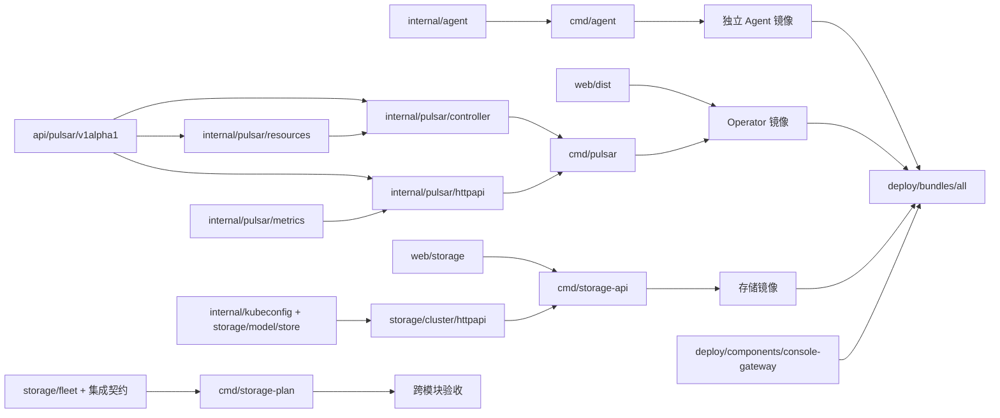

# 项目设计

`pulsar-operator` 是统一交付的仓库：Pulsar、Storage 和 Agent 三个模块共用根 Go module，并保留独立进程、镜像和权限。Pulsar 实现位于 `internal/pulsar`，存储管理代码位于 `internal/storage`，模块契约与镜像位于 `modules/storage`，存储页面位于 `web/storage`；节点设备操作位于 `internal/agent`。三个模块通过 Kubernetes 资源契约集成。本文说明代码边界、构建测试、部署组合和兼容原则；运行流程见 [使用指南](../operations/deployment.md)，控制与数据流见 [架构设计](architecture.md)。

## 1. 仓库组织

```text
pulsar-operator/
├── api/
│   ├── pulsar/v1alpha1/          # PulsarCluster / BookKeeperCluster
│   └── storage/v1alpha1/         # PhysicalDisk / DiskPool；Storage 与 Agent 共用
├── cmd/pulsar/                # Pulsar Go 进程入口：manager + controllers + console
├── cmd/agent/                   # Go 节点 Agent 入口
├── cmd/storage-api/             # Go 存储 API 与嵌入页面入口
├── cmd/storage-plan/            # Go Pulsar 存储清单规划工具
├── cmd/storage-benchmark/       # Go 本地元数据基准工具
├── internal/
│   ├── agent/                   # 独立设备发现、LVM 后端和节点调谐
│   ├── storage/                 # model / httpapi / cluster / store / fleet
│   ├── kubeconfig/              # 显式 Kubernetes 连接及 ServiceAccount 配置
│   └── pulsar/                  # Pulsar 模块实现
│       ├── controller/          # 调谐、扩容、升级、decommission、状态
│       ├── resources/           # Kubernetes 工作负载与配置构造
│       ├── httpapi/             # Pulsar HTTP API、鉴权、前端文件服务
│       └── metrics/             # Prometheus 查询与监控视图
├── web/                         # 公用前端
│   ├── storage/                 # Go embed 包与存储 HTML / CSS / JS
│   ├── scripts/                 # 存储页面检查
│   └── src/
│       ├── ConsoleShell.jsx     # 公用布局：Pulsar / Storage 模块入口
│       ├── routes.js            # 模块菜单、hash 路由和旧链接兼容
│       ├── PulsarWorkspace.jsx  # Pulsar 总览、Broker / Bookie、凭证和轮询
│       ├── workspace.js         # 资源清单、可信关系、读取与写入目标
│       ├── ClusterView.jsx      # 按组件范围展示的详情与操作
│       ├── StorageWorkspace.jsx # 同源存储嵌入、导航与握手
│       └── *.test.js            # 模型与关系契约测试
├── config/
│   ├── pulsar/
│   │   ├── crd/                # PulsarCluster / BookKeeperCluster
│   │   ├── rbac/               # 生成的控制器权限
│   │   ├── manager/            # Operator / Service / 运行身份
│   │   ├── default/            # Pulsar 模块安装入口
│   │   ├── samples/            # Pulsar / 独立 BookKeeper 示例
│   │   └── monitoring/         # 可选 PodMonitor
│   ├── storage/
│   │   ├── crd/                # PhysicalDisk / DiskPool
│   │   ├── rbac/               # Storage API 运行身份与权限
│   │   ├── manager/            # Namespace / API / Service
│   │   ├── default/            # Storage API 与 CRD 安装入口
│   │   └── samples/            # DiskPool / PVC + Pod 示例
│   ├── agent/
│   │   ├── rbac/               # Agent 运行身份与权限
│   │   ├── manager/            # 节点 DaemonSet
│   │   └── default/            # Agent 安装入口，依赖 Storage namespace/CRD
│   └── crd/                    # 引用两个模块 CRD，不包含实例
├── modules/pulsar/
│   ├── docs/、scripts/         # 模块设计、使用、测试说明与命令入口
│   └── Dockerfile              # Pulsar 进程 + 公用 React UI，从仓库根构建
├── modules/storage/
│   ├── docs/、scripts/         # 存储设计、使用、测试与模块命令
│   └── Dockerfile              # Go 存储 API 镜像，从仓库根构建
├── modules/agent/
│   ├── docs/、scripts/         # 模块设计、使用、测试说明与命令入口
│   └── Dockerfile              # Go Agent + Linux LVM/设备工具
├── deploy/
│   ├── bundles/               # all / storage 跨模块部署组合
│   ├── components/            # console-gateway 公共组件
│   ├── overlays/              # two-node 等环境覆盖
│   ├── addons/                # 外部 CSI 的 Helm values，显式安装
│   └── labs/                  # 独立实验清单，不纳入默认部署
├── test/e2e/                  # pulsar / storage / system 真实验收与 lib
├── test/integration/          # pulsar / storage / system 集成检查
├── test/fixtures/             # 跨模块虚构输入与输出示例
├── scripts/
│   ├── init.sh、test.sh       # 仓库环境与测试聚合
│   ├── deploy/               # 组合渲染、环境安装脚本
│   ├── lib/                  # 共用函数
│   └── dev.sh                # 兼容命令分发
├── docs/
│   ├── design/、operations/   # 整体设计、组合部署
│   ├── labs/、testing/        # 实验环境与测试方法
│   └── history/、provenance/  # 历史验收和来源记录
├── .dockerignore               # 三个模块共用的构建上下文排除规则
├── Makefile                    # 统一测试、构建与清单渲染
├── go.mod / go.sum             # Go 模块与依赖锁定
└── README.md                   # 仓库项目功能介绍
```

`config/<模块>` 保存各模块的 Kubernetes 配置：`crd`、`rbac`、`manager`、`default` 和按需使用的 `samples`。Pulsar 额外包含可选 `monitoring`；Agent 复用 Storage CRD，因此没有独立 `crd` 或 CR 示例。`default` 只引用本模块配置；Agent 依赖的 namespace 和 CRD 由 Storage 提供。`deploy/` 表达跨模块装配及环境覆盖，`deploy/bundles/storage` 组合 Storage API 与 Agent，`deploy/bundles/all` 再加入 Pulsar 和公共网关。

HTTP 服务层统一命名为 `internal/<模块>/httpapi`：Pulsar 和 Storage 各有自己的 `Server` 与路由，Agent 通过 Kubernetes 资源协作，没有 HTTP 服务层。Kubernetes 资源类型统一放在 `api/<模块>/<版本>`；`api/storage/v1alpha1` 的设备身份、DiskPool 定义和资源标识由 Storage 与 Agent 共用，Agent 的发现结果和 LVM 执行结果仍属于 `internal/agent/model`。

`make generate` 为两个 API 包生成 DeepCopy。`make manifests` 只生成 `config/pulsar/crd` 下的 Pulsar CRD 与 `config/pulsar/rbac` 下的权限；Storage 的已部署校验规则由 `config/storage/crd` 中两个独立 YAML 维护，目录调整保持 schema、API group、资源名称和 JSON 字段一致。

`config/pulsar/default` 只引用 Pulsar CRD，`config/storage/default` 只引用 Storage CRD；`config/crd` 聚合全部四个定义，方便单独安装 CRD。Agent 没有独立 CRD，复用 Storage 资源。`PhysicalDisk` 由 Agent 发现并上报，不提供伪造设备身份的可直接应用示例；`config/storage/samples/diskpool.yaml` 保持 `approved: false`。默认部署不引用示例目录；环境专用 CR 留在对应 `deploy/` 配置，跨模块规划夹具留在 `test/fixtures/pulsar-storage`，上游字段观察记录在 `docs/provenance/pulsar-storage-contract.json`。

## 2. 模块依赖方向



Pulsar、Storage API 与 Agent 之间不通过内部 RPC 触发磁盘操作。Storage API 将期望状态写入 DiskPool，Go Agent 读取并回写状态。Pulsar 仅引用 `storageClassName` 并声明 PVC 容量；存储模块仅认识 Kubernetes 的卷、类和父资源元数据。这种接口允许分别升级应用控制器或底层 CSI，而不要求整套代码同版本原子发布。

特定 Pulsar 集成逻辑集中在 `internal/storage/fleet`、`test/fixtures/pulsar-storage` 和跨模块测试；设备发现后端不应依赖 Pulsar 的 Pod 命名。新增 Kafka 等负载时复用存储能力并增加自己的契约，不把每种应用名称写入 LVM 执行器。

### 控制台内部边界

| 部分 | 输入与输出 | 设计约束 |
| --- | --- | --- |
| `ConsoleShell.jsx` / `routes.js` | hash → Pulsar / Storage 模块入口、子导航与面包屑 | 公用布局不请求业务 API；兼容旧 Pulsar 链接，不新增历史记录 |
| `PulsarWorkspace.jsx` | `/api/clusters` → 集群总览、Broker / Bookie 列表、关系与详情 | 只在 Pulsar 模块挂载；退出时停止轮询并丢弃过期响应；凭证只用于 Pulsar API |
| `workspace.js` | PSC/BKC 原始对象 → Broker/Bookie 视图与关系 | 显示身份与写入身份分开；严格校验 ownerReference 与 canonical 同名子资源 |
| `ClusterView.jsx` | scoped view → 状态/配置/升级/容量/活动面板 | Broker 不展示 Bookie 卷操作；受管 Bookie 写父 PSC，异常关系只读 |
| `StorageWorkspace.jsx` | 七页菜单选择 → `/storage/?embedded=1` 与导航消息 | 先检查 API，再等待同源 iframe 握手；验证 origin/source 和页面白名单 |
| `web/storage/static` | 嵌入参数与 hash → 原七页交互 | 由 Go API 嵌入提供；隐藏重复导航，保留独立 Token 和 API |
| `internal/pulsar/httpapi` | Kubernetes 对象 → 完整清单、限定范围的 Pod/事件 | 兼容旧字段；后端阻止对受管或孤立 BKC 直接写入 |
| `internal/storage/httpapi` / `cluster` | 存储 API → DiskPool、PVC/PV 与节点视图 | 保留计划确认、外部 PVC 只读、真实绑定与 UID 前置条件 |

视图实体键如 `BookKeeperCluster/ns/name` 用于 Bookie 页面和跳转；受管视图的写入目标仍为父 `PulsarCluster/ns/name`。Pod/事件读取使用子资源身份，监控复用父配置。不能因两者常常同名而合并这两个概念，否则会把请求发给错误 kind，或直接修改随后被父控制器覆盖的子 spec。

配置编辑器保存独立的草稿及其 UID/resourceVersion 基线，轮询只更新服务器视图；保存冲突时保留草稿并提供明确的重新加载操作。所有修改、重启和删除请求使用 `X-Resource-UID`、`X-Resource-Version`。Go API 在原子 JSON Patch 中测试身份与版本，删除用 Kubernetes Preconditions；创建接口不需要这两个头。凭证通过表单输入，已停用 URL query Token 登录，网关日志也不记录 query 或 Referer。

前端关联状态为 linked、pending、orphan、standalone。关联必须符合 namespace、API group、controller ownerReference、父 UID 与 canonical 同名约定。后端清单新增 `allBookkeeper`，保留原 `bookkeeper` 和 `children`；孤立资源在完整清单中可见，但不能作为独立 BKC 写入。UI 不建立新 CRD 或额外的外部 BookKeeper 共享关系。

## 3. 语言、运行时与构建制品

| 制品 | 构建输入 | 运行内容 | 发布要求 |
| --- | --- | --- | --- |
| Go Operator 二进制 | `go.mod`、`api`、`cmd`、`internal` | 两个控制器、Pulsar API、指标服务 | 与本次 CRD/RBAC 版本成套发布 |
| 公用 Web 静态资源 | `web/package-lock.json`、React 源码 | `web/dist` | 由 Go 服务提供；随 Operator 镜像发布 |
| Pulsar 镜像 | `modules/pulsar/Dockerfile` | 非 root Go 进程 + `/web` | 使用提交号标签和镜像 digest |
| 存储镜像 | `modules/storage/Dockerfile` | Go 存储 API、嵌入页面、纯 Go SQLite 驱动 | 从仓库根构建，单独 Deployment 与 ServiceAccount |
| Agent 镜像 | `modules/agent/Dockerfile` | Go Agent、LVM/设备工具 | 从仓库根构建，单独 DaemonSet 与 ServiceAccount |
| nginx 入口配置 | `deploy/components/console-gateway` | 路径代理 | 采用固定版本镜像；入口不保存业务令牌 |
| Kubernetes 清单 | CRD、RBAC、Deployment、DaemonSet、聚合 Kustomization | 集群安装产物 | 渲染审查后按环境应用 |
| 集成规划清单 | Ready 池、角色分配与容量预检 | Namespace、共享 SC、PulsarCluster | 属于环境配置，提交前移除凭证 |

三个 Dockerfile 均按 `modules/<模块>/Dockerfile` 组织，以仓库根目录为构建上下文，复用根 `.dockerignore`。各构建阶段只复制自身源码与必要共享依赖；Pulsar 镜像同时构建并提供根 `web/` 下的公共前端，Storage 镜像通过 Go embed 提供存储页面。

当前 Go 模块声明 Go 1.26.0，三个后端镜像的构建阶段使用 Go 1.26；Pulsar 页面使用 Node 22，前端依赖由 lockfile 固定。Storage API 使用 `modernc.org/sqlite`，在 `CGO_ENABLED=0` 下构建，保留原 `state.sqlite3` 的表结构与整数数据。三个后端运行镜像均不需要 Python；仓库测试及部署/E2E 辅助脚本仍可能使用 Python 标准库。实际开发机应以仓库中的 manifest 为准，不为消除工具缺失而擅自降低 Go/Kubernetes 依赖版本。

Agent 与 Storage API 已迁入同一个 Go module，分别使用独立镜像。API 没有 privileged 或宿主机盘挂载，Agent 保留自己的设备权限、ServiceAccount 和 RBAC。首次从 Python 版本更新时，Agent DaemonSet 的 command 改为 `/usr/local/bin/diskfleet-agent`，Storage API Deployment 改为 `/usr/local/bin/diskfleet-api`；各自的 image 和 command 必须同时切换。

## 4. 构建与开发入口

模块脚本按 init、build、run、test、deploy、generate 拆分，`dev.sh` 只分发命令；公共前端按 init、build、run、test 拆分。根 `scripts` 聚合仓库操作，Makefile 提供别名。环境初始化见[脚本说明](../../scripts/README.md)。

| 命令 | 工作内容 | 前置条件与判断标准 |
| --- | --- | --- |
| `make test-offline` | 全部单元、Storage 集成与系统检查 | Go、Node/npm、Python；依赖缓存就绪后不需要 envtest 或真实集群 |
| `make test-go` | Go 单元与控制器 envtest | Go、envtest 二进制；第一次可能需要下载 |
| `make test-web` | Pulsar 前端模型测试 / 项目配置中的构建检查 | Node/npm 及锁定依赖 |
| `make test-agent` | Go Agent 单元与恢复测试 | 不需要 envtest、集群或真实设备 |
| `make build-agent` / `make image-agent` | 独立 Agent 二进制 / 镜像 | 镜像从仓库根 context 构建 |
| `make test-storage` | Go 存储单元、HTTP、模拟 Kubernetes 与规划测试 | Go；不写物理盘，不连接真实 Kubernetes |
| `make build-storage` / `make image-storage` | `diskfleet-api`、`storage-plan`、`storage-benchmark` / 存储 API 镜像 | 镜像从仓库根 context 构建，嵌入原生存储页面 |
| `make test-repository` | 预构建存储工具后运行仓库入口与清单检查 | Go 与 Python；有 kubectl 时验证实际清单渲染 |
| `make image-pulsar`（兼容 `make image`） | Pulsar 镜像和公共前端 | 从仓库根 context 构建，`IMG` 指定镜像名称 |
| `make images` | 构建 Operator、Storage API 与 Agent 三个镜像 | 容器构建工具、镜像源网络、所需架构 |
| `make render` | 渲染统一部署清单 | 支持 Kustomize 的 kubectl；渲染不代表安装或运行 |
| `make generate` / `make manifests` | 更新 deepcopy、CRD 与 Go RBAC | Go/controller-gen；应审查生成差异 |
| `make build` / `make web` | 单独编译 Go / 构建 Pulsar 页面 | Go 或 Node/npm |
| `make demo-storage` | Go 存储模拟页面，复用 `modules/storage/.state` | Go；需要允许监听回环端口 |
| `make benchmark-storage ARGS="--disks 10000"` | 本地 SQLite 元数据基准 | Go；临时数据库，不代表真实块存储性能 |
| `make inspect-disks` | 构建并执行 Go Agent `--discover` | Go 与 Linux，只读宿主机盘清单，不访问 Kubernetes |
| `make prepare-pulsar ARGS="..."` | 从 Ready 池生成集成清单 | 显式 Kubernetes API 连接；只生成、不应用 |
| `make e2e-storage STORAGE_CLASS=...` | 真实存储验收入口 | 已核验单池类与专用集群 |
| `make e2e-pulsar-storage NAMESPACE=... CLUSTER=...` | 默认三节点 Pulsar 存储验收入口 | 至少三节点、journal/ledger 分盘的专用集群 |
| `make e2e-pulsar-shared-disk NAMESPACE=... CLUSTER=...` | 独立两节点共享数据盘验收入口 | 显式 `two-node-shared-disk-lab`；两块已核验数据盘与 Ready 池 |

`make test` 依次涵盖全部 Go/envtest 测试、Web 模型与构建、存储页面 JavaScript 检查和仓库检查。存储页面的 `web/scripts/check-storage-ui.cjs` 由 `make test-integration-storage` 执行，使用 Go API 提供的模拟快照。默认镜像名为 `pulsar-operator:dev`、`pulsar-operator-storage:dev`、`pulsar-operator-agent:dev`，可以通过 `IMG`、`STORAGE_IMG`、`AGENT_IMG` 修改；构建参数不会自动改写部署环境中的镜像地址。

本地开发存储页面可以使用 demo 模式，其默认数据为模拟节点/盘。demo 中的“容量”是模型约束，不创建真实 PV、磁盘配额或内核挂载。cluster 模式必须接入 Kubernetes API，页面的事实来源改为 CR/PVC/PV；两种模式应在 UI 上清晰标识。

`test-offline` 包含前端构建，但不能替代 envtest 或真实 E2E。缺少工具时应记录“未执行及原因”，不把跳过项报告为通过。

## 5. 测试分层与验收证据

### 层级与职责

`make test-unit` 运行全部模块与公用代码单测；`make test-integration` 运行各模块集成；`make test-system` 验证跨模块契约、网关、部署和入口。`make test` 聚合这三层。真实集群 E2E 独立执行。

包内单测继续紧邻源码；需要私有测试夹具的 envtest 使用 `integration` build tag，Storage/Agent 契约使用 `systemintegration` tag。可独立运行的模块测试归 `test/integration/<模块>`，总集成归 `test/integration/system`。详细位置、命令、依赖及证明边界见[测试指南](../testing/README.md)。

### Pulsar 集成验收设计

验收使用专属 `diskfleet-pulsar-...` 命名空间和带集成标记的资源，先检查当前 Kubernetes context，再进行任何集群修改。测试输入来自已准备好的 Ready 池，不包含自动 wipe、`pvcreate` 或对未知宿主盘的初始化。

默认 `three-node-e2e` 仍要求至少三个节点、Required 反亲和、journal/ledger 独立物理池。`two-node-shared-disk-lab` 使用独立标签与入口 `test/e2e/system/pulsar-shared-disk.sh`，只接受恰好两个目标节点、三个角色共用同一组两个池和 Preferred 反亲和；它不以宽松参数绕过原三节点验收。两个 profile 的结果分别记录，不能互相替代。

核心步骤为：

1. 校验真实 CRD/父 CR 与依赖组件的状态、`observedGeneration`，至少三个 ZooKeeper 和三个 bookie。
2. 核对实际 PVC/PV 的 claim UID、CSI driver、StorageClass、VG 精确选择、hostname 拓扑、Retain/thick 参数，以及 Pod 的反亲和分散和挂载路径。
3. 以实际 Pulsar 容器用户在 bookie-0 的 journal/ledger 写入唯一标记，并同步到磁盘，验证镜像用户与卷权限兼容。
4. 生产 20 条消息，保留唯一订阅；重建 bookie-0，确认 Pod UID 变化，重新读取两个标记并消费原消息。
5. 修改父 PulsarCluster 的 ledger 容量 +1 GiB，等待各 PVC 扩容及 Pod 内文件系统增长，核对 PVC/PV 身份不变。
6. 使用独立 1 GiB 探针 PVC 验证删除后 PV Released；不删除业务 PVC 验证 Retain。

脚本保留证据、扩容后的集群、标记文件、测试主题/订阅及 Retain 探针 PV/LV，避免“清理”掩盖恢复结果。完成后必须按使用指南登记和处理测试资源。上述设计不声称验证了 bookie decommission，后者需要单独准备容量和副本恢复场景。

### 集群验收范围

真实集群验收应覆盖 PVC/PV 身份、拓扑、挂载、消息保留、卷扩容和 Retain。两节点实验不能替代三节点分盘、节点/磁盘故障、decommission、规模和长期稳定性验收；浏览器交互也需单独验证。历史执行结果及其镜像范围见[验证记录](../history/validation.md)。

## 6. 部署组合

下表区分基础部署入口和存储规划 profile；profile 由生成器校验，不要求各自拥有同名 Kustomize overlay。环境差异通过 overlay 固化，复用基础资源。

| 组合 | 入口与用途 | 写盘 / 外部依赖 |
| --- | --- | --- |
| 本地演示 | `modules/storage` demo API/UI | 模拟盘；不依赖 Kubernetes/CSI |
| Pulsar 独立 | `config/pulsar/default` | 使用现有 StorageClass；无 DiskFleet Agent |
| 存储只读发现 | `deploy/bundles/storage` 聚合 Storage API 与 Agent，Agent 写开关保持 false | 需要 Linux 节点与 Kubernetes；不初始化盘 |
| 存储供卷 | 存储部署 + OpenEBS LVM CSI + 审核后的池 | 明确启用 Agent 写入，逐盘审核 |
| 默认集成验收 | `deploy/bundles/all` + CSI + `three-node-e2e` 规划 | 至少三节点、journal/ledger 分盘、Required 反亲和 |
| 两节点分盘实验 | `deploy/overlays/two-node` + CSI + `two-node-lab` 规划 | 两节点；journal/ledger 分盘、Preferred 反亲和 |
| 两节点共享数据盘实验 | `deploy/overlays/two-node` + CSI + `two-node-shared-disk-lab` 规划 | 每节点一块独立数据盘，三角色共用各自节点的 VG；独立验收入口 |
| 生产候选 | 在聚合资源上维护环境 overlay | 需落实 TLS、令牌、审计持久化、备份、容量与恢复验收 |

统一聚合不会安装外部 CSI，也不会自动挑盘或批准磁盘写入。存储 Agent 默认 `ENABLE_DISK_WRITES=false`；聚合安装只是把资源与服务放入集群，不等于存储池已经可供使用。聚合层设置 Pulsar、Storage API、Agent 三个开发镜像，并将 Pulsar Token Secret 改为必需；独立 `config/pulsar/default` 保留上游基线行为。

共享数据盘 profile 为本次两块 100 GiB 数据盘实验单独增加，必须显式选择。每池预检至少 94 GiB 实际空闲容量，覆盖 Preferred 可能集中放置的三个角色与扩容/保留探针；三个角色仍生成独立 StorageClass 和 LV/PVC。它不改变默认三节点角色分盘规则，也不提供 journal/ledger 物理 I/O 隔离或主机故障高可用。步骤与容量计算见[共享数据盘指南](../labs/shared-data-disk.md)。

默认 namespace 保持 `pulsar-operator-system` 与 `diskfleet-system`；统一 nginx 跨 namespace 通过 Service DNS 路由。分 namespace 有助于权限与运维分工，但不构成物理网络隔离。正式环境按自己的 Ingress/Gateway 和网络策略配置访问边界。

不要给全局聚合资源随意添加统一 `namePrefix` 或改 namespace 后直接应用：网关上游 DNS、RBAC subjects、Secret 引用、已有 ownerReferences 和外部契约可能需要联动调整。更名应作为有迁移方案的变更。

## 7. 开发约定

### 控制器与资源模型

- Kubernetes spec 表达期望，status 表达观察结果；不要让控制器以更新 status 的方式隐式改变用户 spec。
- 调谐必须幂等；使用 UID/resourceVersion 区分同名重建的资源，`observedGeneration` 表示处理到的版本。
- Pulsar 生命周期规则放在 Go 控制器，资源构造放在 `internal/pulsar/resources`；UI 通过父 CR 修改期望值。
- 生产物理设备写入只能经过 `internal/agent/lvm` 的核验、锁、日志和批准流程，不允许在 API/前端/脚本中拼接任意 shell 命令。
- 节点标签只是筛选条件；任何宿主机操作仍要核对完整 nodeName、稳定路径、序列号和字节容量。
- status 更新应避免无变化的写请求；对冲突、暂时性失败和永久性配置错误给出可区分的消息。

### API 与前端

- Pulsar UI 与存储 UI 采用各自 API 和 token；统一入口仅改变地址，不扩大生命周期权限。
- Broker/Bookie 使用独立列表与详情，受管 Bookie 的副本、配置、镜像、容量修改必须写父 `spec.bookkeeper`；readTarget 与 mutation target 不得混用。
- 关系判断必须核对 ownerReference、namespace、UID 和 canonical 子名称；有所有权证据但关系异常时只读，禁止按同名或标签自动接管。
- 存储嵌入消息只允许规定通道、kind 与页面键；两端检查 origin/source，不发送 Token，不能把 iframe load 当作 API 就绪。
- 所有外部操作结果区分“请求已接受”“资源已创建”“卷已绑定”“文件系统扩容完成”。
- 外部 PVC 以只读方式展示，界面引导用户回到父 PulsarCluster 调整；后端同样执行所有权校验，不能只隐藏按钮。
- 模拟页面必须保留模式提示；禁止把 demo 的目录路径或逻辑配额宣传为真实挂载。
- 新增存储页面请求需要同时考虑独立根路径与 `/storage/` 代理前缀，防止误请求 Pulsar `/api/`。

### 测试与提交

修改 API Go 类型后更新生成代码/CRD，修改 RBAC 标记后审查生成角色。修改共享类/卷所有权时补充契约测试；修改真实盘初始化时测试身份变更、崩溃恢复、并发锁、已有数据与缺失证据等失败路径。测试重点是数据安全边界，而非简单复述函数内部实现。

依赖升级同时审查 `go.mod/go.sum`、前端 lockfile、镜像基础版本与 API 支持范围。不要只改 manifest 的版本号就认定升级兼容。提交说明记录问题、行为变化、验证范围与未执行原因。

## 8. 数据与配置的版本管理

可以进入仓库的内容包括 CRD、部署模板、无密钥示例、集成契约、测试与架构决策。不得提交令牌、kubeconfig 凭证、用户数据、含敏感字段的审计库、宿主机初始化日志或真实磁盘快照。生成的构建目录、虚拟环境、Node 依赖、测试临时数据库和验收运行输出应被忽略或单独归档。

运行证据至少记录：代码提交、上游对照 revision、Operator/storage/CSI 镜像 digest、Kubernetes 版本、节点与磁盘类型、CR/PVC/PV UID、开始结束时间、关键命令输出和失败步骤。涉及设备身份的日志按运维权限保存；公开报告只保留完成复核所需字段。

物理盘初始化日志与 API 审计有不同生命周期：前者用于判定已有 PV/VG 是否属于本系统，丢失后不能凭同名 VG 直接继续；后者用于追踪谁在何时批准计划。Storage 与 Pulsar 各自使用独立管理 PVC 保存 SQLite 状态，采用单副本 Recreate 更新；备份、容量和访问策略由部署环境配置。

## 9. 上游来源与兼容

本仓库保留 `github.com/SongOf/pulsar-operator` Go module 与 `pulsar.songof.dev/v1alpha1` API。已通过 Git 核实上游完整基线 `3c042c57a79e83cd3f329c7088a65e2bc65a62af` 并恢复其历史；不能把浮动 `main` 或 `latest` 当作固定兼容基准。[源码来源记录](../provenance/README.md) 与 [导入清单](../provenance/upstream-source.json) 保存了 59 个文件的来源和原导入摘要。最初读取器归一化过部分空行，导入摘要不是原始 Git blob 的承诺。

Storage 与 Agent 分别位于 `internal/storage` 和 `internal/agent`。兼容约束覆盖 `storage.diskfleet.io/v1alpha1`、namespace、labels、finalizer、HTTP 路径、JSON 字段、宿主设备所有权日志和 SQLite 表结构。规划、基准与设备发现使用 Go CLI；Python 标准库工具只负责仓库检查、部署辅助和实验探针。

升级前分别保存 Agent 的宿主日志和 Storage API 的一致性 SQLite 备份。管理服务使用独立 PVC，Pod 替换时继续挂载原状态卷。若现有部署仍使用临时目录，须在替换 Pod 前完成一致性备份与状态恢复，避免丢失操作计划、审计和未完成的释放意图。WAL 模式下不能把单独复制主数据库文件当作完整在线备份。

升级已有部署时遵循以下顺序：

1. 导出 CR、SC、PV/PVC 身份和当前镜像配置，保留宿主机初始化日志与 API 审计。
2. 渲染新清单，对比 CRD schema、RBAC、namespace/name、镜像及默认写开关；确认无非预期对象替换。
3. 更新镜像与服务入口，先只读核对原池与外部 PVC，避免同时改变设备身份、StorageClass 和控制器版本。
4. 验证原有 PVC/PV UID、VG 身份、Pod 挂载和读写；再启用新管理入口的写操作。
5. 保持回退镜像可用；CRD/状态结构升级若不可逆，必须先准备专门迁移与回退策略。

移除旧控制器前确认不会有两个版本同时调谐同一资源；Pulsar 的 leader election 配置与存储 Agent 的 DaemonSet 替换策略都需保持一致。集成仓库不改变外部 CSI 对卷的所有权，也不因更新管理 UI 而卸载 CSI。

## 10. 架构决策记录（ADR）

### ADR-001：Pulsar、Storage、Agent 共用 Go 工程并独立部署

**决定：**Pulsar、Storage API 与 Agent 共用根 Go module，分别保留进程、镜像、ServiceAccount 和权限。Storage 的 HTTP、Kubernetes 管理、SQLite 状态和规划工具使用 Go 实现；存储原生 JavaScript 页面由 Go 嵌入，当前 React/iframe 组合继续使用。

**理由：**在明确模块职责的同时统一后端工具链，复用 Kubernetes 客户端，保留 DiskPool/PhysicalDisk、宿主恢复日志、原 API 和 SQLite 状态契约。API 仍只修改 Kubernetes 期望状态，节点设备操作仅由 Agent 执行。

**代价：**需要验证旧日志与数据库、HTTP 行为、释放恢复和并发事务兼容；发布前须在目标 Linux/CSI 完成验收。仓库/E2E 辅助工具仍使用 Python，前端保留 React 与原生 JavaScript；这些工具和页面不属于 Go 业务运行代码。


### ADR-002：以 Kubernetes 存储对象作为集成接口

**决定：**Pulsar 只引用 StorageClass/PVC，不调用磁盘 API；存储模块不直接操纵 Pulsar StatefulSet。

**理由：**资源生命周期有单一负责方，避免两个控制器争抢 PVC；可保留对其他 CSI 和其他应用的扩展能力。

**代价：**必须把父 CR、PVC、SC、PV、池和设备串联展示，并通过 UID 与拓扑校验确保观察关系真实。

### ADR-003：不自行实现 CSI

**决定：**Agent 只准备 PV/VG，LV、文件系统与挂载交给 OpenEBS LVM LocalPV CSI。

**理由：**CSI/kubelet 已定义卷生命周期，复用其调度、扩容和挂载协议，避免应用 Operator 手工维护宿主机挂载。

**代价：**CSI 是显式外部依赖，需独立安装、锁定版本并验收。单元测试不能代替目标 CSI 的真实运行验证。

### ADR-004：单盘单 VG、thick 分配、默认 Retain

**决定：**当前池只接管一块空闲物理盘，CSI 使用非 thin 配置，SC 使用 Retain。

**理由：**磁盘与池身份明确、故障定位直接、容量不依赖超卖，删除 PVC 后提供人工恢复窗口。

**代价：**不能动态把多盘合入一个池，留存卷持续占用容量，必须设计人工回收。Retain 不等于副本或备份。

### ADR-005：共享类采用审核快照

**决定：**为多节点 StatefulSet 生成共享 StorageClass，使用池 UID、精确 VG 集合与 hostname 集合；暂不新增自动 PoolGroup 控制器。

**理由：**解决单节点类与副本分散的真实冲突，同时使可用设备集合可审核，降低误选盘风险。

**代价：**新节点/池不会自动加入已有快照；长期池扩展、调度与迁移需进一步设计，不能靠修改现有 Pulsar 的 storageClassName 实现。

### ADR-006：统一入口保留两套凭证

**决定：**根目录 `web/` 保持公用 React 前端，提供 Pulsar / Storage 两个一级入口；Pulsar 内含总览、Broker 与 Bookie，Storage 内含七个存储页面。模块工作区分别维护 API 连接和凭证；同源 iframe 复用完整存储页面，nginx 提供 `/` 和 `/storage/`，路由各自 API。导航协议不传 Token，代理不静态注入另一系统的令牌。

**理由：**保留已有七页存储交互与后端保护逻辑，让用户在一个工作空间管理组件与磁盘，同时避免把一个管理 Token 隐式提升为全部磁盘权限。

**代价：**仍需维护 React 与原生页面两套前端；需要双向导航、加载/错误状态、同源嵌入策略与单独浏览器测试。当前分别登录，同源 iframe 不是浏览器强隔离。SSO、细粒度租户权限与独立域名策略属于后续工程。

### ADR-007：将离线证据与真实 E2E 分开

**决定：**提供可在受限环境运行的离线检查，同时保留需要真实节点、CSI、Pulsar 和设备权限的 E2E。

**理由：**保护既有数据并准确表达验证范围；mock、envtest、模板检查不能证明真实挂载或消息持久性。

**代价：**发布前必须有独立集群验收资源与记录。已完成的两节点真实实验、尚未执行的三节点分盘与故障验收分别标记，不用演示或实验 profile 的结果替代其他验收范围。

### ADR-008：组件独立视图保留原控制器所有权

**决定：**Broker 与 Bookie 拥有独立入口、列表、状态与操作面板，已确认的受管 BKC 通过父 PSC 接受变更；双向关系来自 UID 验证的 controller ownerReference，并遵守当前同名子资源契约。

**理由：**匹配计算组件与持久化组件分别运维的需求，同时保持父控制器对 bookkeeper spec 的单一权威。新增 `allBookkeeper` 兼容字段让受管、独立和孤立资源都可见，防止仅展示独立列表造成状态盲区。

**代价：**展示对象和写入对象可能不同，需专门的模型与接口测试。当前不支持多个 PSC 复用一个外部 BKC；未来若引入 externalRef，需要同步设计控制器、状态、删除和权限语义，不能仅添加 UI 选择器。

## 11. 发布前的完成标准

一次可追踪的集成发布至少应满足：依赖与来源固定；Go/Web/存储检查通过；CRD/RBAC/聚合清单可渲染；三节点真实 CSI/Pulsar 验收有证据；权限、TLS、审计持久化和 Retain 容量处理有环境配置；升级与回退路径经过评审。

涉及大规模物理盘管理的发布，还需给出明确节点数、盘数、PVC 数、请求并发、收敛时延、故障注入与长稳时间。没有这些记录时，功能可以被描述为“提供规模管理基础能力”，不应宣称已满足某个生产规模或高可用等级。
