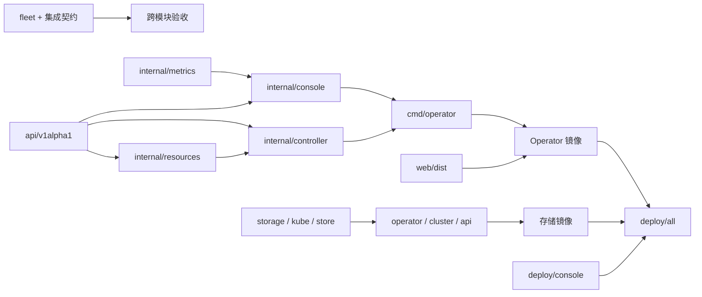

# 项目设计

`pulsar-operator` 是统一交付的仓库：上游 Pulsar 控制器保留 Go 工程结构，物理存储能力封装在 `modules/storage`，两者通过 Kubernetes 原生存储对象集成。本文说明代码边界、构建测试、部署组合和兼容原则；运行流程见 [使用指南](user-guide.md)，控制与数据流见 [架构设计](architecture.md)。

## 1. 仓库组织

```text
pulsar-operator/
├── api/v1alpha1/                 # PulsarCluster / BookKeeperCluster Go API
├── cmd/operator/                # Go 进程入口：manager + controllers + console
├── internal/
│   ├── controller/              # 调谐、扩容、升级、decommission、状态
│   ├── resources/               # Kubernetes 工作负载与配置构造
│   ├── console/                 # Pulsar HTTP API、鉴权、前端文件服务
│   └── metrics/                 # Prometheus 查询与监控视图
├── web/                         # React/Vite 统一控制台
│   └── src/
│       ├── ConsoleShell.jsx     # 总览 / Broker / Bookie / 物理存储主布局
│       ├── workspace.js         # 资源清单、可信关系、读取与写入目标
│       ├── ClusterView.jsx      # 按组件范围展示的详情与操作
│       ├── StorageWorkspace.jsx # 同源存储嵌入、导航与握手
│       └── *.test.js            # 模型与关系契约测试
├── config/
│   ├── crd/                     # Pulsar 两个 CRD
│   ├── rbac/                    # Pulsar 控制器权限
│   ├── manager/                 # Operator Deployment / Service
│   ├── default/                 # 独立 Pulsar 安装入口
│   ├── samples/                 # Pulsar / BookKeeper CR 示例
│   └── monitoring/              # 可选 Prometheus Operator 抓取配置
├── modules/storage/
│   ├── diskfleet/
│   │   ├── api.py               # HTTP API 与静态页面服务
│   │   ├── cluster.py           # Kubernetes 真实管理后端
│   │   ├── kube.py              # 标准库 Kubernetes 客户端与分页
│   │   ├── operator.py          # 每节点 Agent 调谐入口
│   │   ├── storage.py           # 设备发现、LVM 写入边界、恢复日志
│   │   ├── fleet.py             # 多节点存储类与 Pulsar 清单规划
│   │   ├── store.py             # 演示数据、计划与审计存储
│   │   └── static/              # 存储原生 HTML / CSS / JavaScript 控制台
│   ├── deploy/                 # 存储 CRD / API / Agent / RBAC
│   ├── integrations/pulsar/    # 对接上游版本的字段与行为契约
│   ├── scripts/                # 检查、规划、benchmark、存储与 Pulsar E2E
│   ├── tests/                  # Python 单元、集群后端、契约、页面测试
│   ├── docs/                   # 物理盘操作、原有验证与集成细节
│   ├── pyproject.toml          # 自包含 diskfleet Python 包
│   └── Dockerfile              # Agent / API 共用基础镜像
├── deploy/
│   ├── all/                    # Pulsar + 存储 + 统一入口的 Kustomize 聚合
│   ├── console/                # nginx 路由、Deployment 与 Service
│   ├── two-node/               # 两节点管理面 overlay 与固定 CSI 配置
│   └── system-disk-lab/        # 独立的系统目录联调配置；不作为真实 LVM 验收
├── test/e2e/                   # 跨模块验收统一入口与上游验收
├── tests/                      # 仓库组合、网关、来源与入口契约测试
├── scripts/                    # 产品层规划工具入口
├── docs/                       # 产品架构、项目设计、使用与来源说明
├── Dockerfile                  # Go Operator + 构建后的 React UI
├── Makefile                    # 统一测试、构建与清单渲染
├── go.mod / go.sum             # Go 模块与依赖锁定
└── README.md                   # 产品入口、快速开始、验证状态
```

`config/` 保持上游结构，便于跟踪升级；`deploy/` 表达统一产品装配；`modules/storage/deploy/` 表达存储模块自身部署。三个目录层次不同，避免把聚合入口复制成另一套会漂移的 CRD。

## 2. 模块依赖方向



Go 与 Python 不互相 import，也不通过内部 RPC 触发磁盘操作。Pulsar 仅引用 `storageClassName` 并声明 PVC 容量；存储模块仅认识 Kubernetes 的卷、类和父资源元数据。这种接口允许分别升级应用控制器或底层 CSI，而不要求整套代码同版本原子发布。

特定 Pulsar 集成逻辑集中在 `fleet.py`、`integrations/pulsar` 和跨模块测试；设备发现后端不应依赖 Pulsar 的 Pod 命名。新增 Kafka 等负载时复用存储能力并增加自己的契约，不把每种应用名称写入 LVM 执行器。

### 控制台内部边界

| 部分 | 输入与输出 | 设计约束 |
| --- | --- | --- |
| `ConsoleShell.jsx` | `/api/clusters` → 四个工作空间、列表、关系导航与详情 | hash 路由保存所选组件/存储页面；Pulsar 连接失败不阻止单独进入存储入口 |
| `workspace.js` | PSC/BKC 原始对象 → Broker/Bookie 视图与关系 | 显示身份与写入身份分开；严格校验 ownerReference 与 canonical 同名子资源 |
| `ClusterView.jsx` | scoped view → 状态/配置/升级/容量/活动面板 | Broker 不展示 Bookie 卷操作；受管 Bookie 写父 PSC，异常关系只读 |
| `StorageWorkspace.jsx` | 七页菜单选择 → `/storage/?embedded=1` 与导航消息 | 先检查 API，再等待同源 iframe 握手；验证 origin/source 和页面白名单 |
| 存储 `static/app.js` / CSS | 嵌入参数与 hash → 原七页交互 | 隐藏重复导航；保留独立 Token 和 API；不把存储操作复制到 React |
| `internal/console` | Kubernetes 对象 → 完整清单、限定范围的 Pod/事件 | 兼容旧字段；后端阻止对受管或孤立 BKC 直接写入 |

视图实体键如 `BookKeeperCluster/ns/name` 用于 Bookie 页面和跳转；受管视图的写入目标仍为父 `PulsarCluster/ns/name`。Pod/事件读取使用子资源身份，监控复用父配置。不能因两者常常同名而合并这两个概念，否则会把请求发给错误 kind，或直接修改随后被父控制器覆盖的子 spec。

配置编辑器保存独立的草稿及其 UID/resourceVersion 基线，轮询只更新服务器视图；保存冲突时保留草稿并提供明确的重新加载操作。所有修改、重启和删除请求使用 `X-Resource-UID`、`X-Resource-Version`。Go API 在原子 JSON Patch 中测试身份与版本，删除用 Kubernetes Preconditions；创建接口不需要这两个头。凭证通过表单输入，已停用 URL query Token 登录，网关日志也不记录 query 或 Referer。

前端关联状态为 linked、pending、orphan、standalone。关联必须符合 namespace、API group、controller ownerReference、父 UID 与 canonical 同名约定。后端清单新增 `allBookkeeper`，保留原 `bookkeeper` 和 `children`；孤立资源在完整清单中可见，但不能作为独立 BKC 写入。UI 不建立新 CRD 或额外的外部 BookKeeper 共享关系。

## 3. 语言、运行时与构建制品

| 制品 | 构建输入 | 运行内容 | 发布要求 |
| --- | --- | --- | --- |
| Go Operator 二进制 | `go.mod`、`api`、`cmd`、`internal` | 两个控制器、Pulsar API、指标服务 | 与本次 CRD/RBAC 版本成套发布 |
| Pulsar Web 静态资源 | `web/package-lock.json`、React 源码 | `web/dist` | 由 Go 服务提供；随 Operator 镜像发布 |
| Operator 镜像 | 根 `Dockerfile` | 非 root Go 进程 + `/web` | 使用提交号标签和镜像 digest |
| 存储镜像 | `modules/storage/Dockerfile` | Python、LVM/设备工具、存储静态页面 | API/Agent 通过不同 command 和权限运行 |
| nginx 入口配置 | `deploy/console` | 路径代理 | 采用固定版本镜像；入口不保存业务令牌 |
| Kubernetes 清单 | CRD、RBAC、Deployment、DaemonSet、聚合 Kustomization | 集群安装产物 | 渲染审查后按环境应用 |
| 集成规划清单 | Ready 池、角色分配与容量预检 | Namespace、共享 SC、PulsarCluster | 属于环境配置，提交前移除凭证 |

当前 Go 模块声明 Go 1.26.0，根 Dockerfile 的构建阶段使用 Go 1.26 与 Node 22；前端依赖由 lockfile 固定。Python 模块声明 Python ≥3.10，镜像使用 Python 3.12，运行时代码不依赖第三方 Python 库。实际开发机应以仓库中的 manifest 为准，不为消除工具缺失而擅自降低 Go/Kubernetes 依赖版本。

存储 API 与 Agent 共用镜像是为了复用发现与客户端代码，权限来自 Pod 配置而不是“镜像会用到的最大能力”。API 不因此获得 privileged 或宿主机盘挂载。以后可进一步拆分只含 API 所需文件的精简镜像；当前不把这种拆分当作已经完成。

## 4. 构建与开发入口

根 Makefile 将常用操作统一到产品层；进入 `modules/storage` 仍可独立开发存储模块。

| 命令 | 工作内容 | 前置条件与判断标准 |
| --- | --- | --- |
| `make test-offline` | 无真实 Kubernetes/块设备的统一离线检查 | Python；覆盖源码/集成契约、模板和结构检查，具体项目以 Makefile 为准 |
| `make test-go` | Go 单元与控制器 envtest | Go、envtest 二进制；第一次可能需要下载 |
| `make test-web` | Pulsar 前端模型测试 / 项目配置中的构建检查 | Node/npm 及锁定依赖 |
| `make test-storage` | Python 存储测试 | Python ≥3.10；不写物理盘 |
| `make images` | 构建 Operator 与 storage 镜像 | 容器构建工具、镜像源网络、所需架构 |
| `make render` | 渲染统一部署清单 | 支持 Kustomize 的 kubectl；渲染不代表安装或运行 |
| `make generate` / `make manifests` | 更新 deepcopy、CRD 与 Go RBAC | Go/controller-gen；应审查生成差异 |
| `make build` / `make web` | 单独编译 Go / 构建 Pulsar 页面 | Go 或 Node/npm |
| `make demo-storage` / `make inspect-disks` | 存储模拟页面 / 只读宿主机盘清单 | Python；前者需要允许监听回环端口 |
| `make prepare-pulsar ARGS="..."` | 从 Ready 池生成集成清单 | 显式 Kubernetes API 连接；只生成、不应用 |
| `make e2e-storage STORAGE_CLASS=...` | 真实存储验收入口 | 已核验单池类与专用集群 |
| `make e2e-pulsar-storage NAMESPACE=... CLUSTER=...` | 默认三节点 Pulsar 存储验收入口 | 至少三节点、journal/ledger 分盘的专用集群 |
| `make e2e-pulsar-shared-disk NAMESPACE=... CLUSTER=...` | 独立两节点共享数据盘验收入口 | 显式 `two-node-shared-disk-lab`；两块已核验数据盘与 Ready 池 |

`make test` 依次涵盖 Go/envtest、Web 模型与构建、存储页面 JavaScript 检查以及离线测试。`make test-web` 还执行存储页面的 `check-ui.cjs`，因为它同样需要 Node。默认镜像名为 `pulsar-operator:dev`、`pulsar-operator-storage:dev`，可以通过 `IMG`、`STORAGE_IMG` 修改；构建参数不会自动改写部署环境中的镜像地址。

本地开发存储页面可以使用 demo 模式，其默认数据为模拟节点/盘。demo 中的“容量”是模型约束，不创建真实 PV、磁盘配额或内核挂载。cluster 模式必须接入 Kubernetes API，页面的事实来源改为 CR/PVC/PV；两种模式应在 UI 上清晰标识。

不要用 `test-offline` 的通过替代 `test-go`、前端构建或真实 E2E。缺少工具时应记录“未执行及原因”，不把跳过项报告为通过。

## 5. 测试分层与验收证据

### 层级与职责

| 层级 | 位置 | 证明什么 | 不能证明什么 |
| --- | --- | --- | --- |
| Go 纯逻辑测试 | `internal/resources`、`internal/console`、`internal/metrics` | 资源构造、API 行为、配置与监控计算 | 真实调度、挂载或 Pulsar 消息链路 |
| 控制器 envtest | `internal/controller` | 真实 API Server/etcd 下的调谐与状态行为 | envtest 通常无 kubelet/CSI，不执行业务 Pod |
| Web 模型与构建 | `web/src/*.test.js`、Vite | 页面模型转换、父子关系与写入目标、前端编译产物 | 浏览器交互与后端联通 |
| 存储单元测试 | `modules/storage/tests` | 身份保护、命令边界、幂等、恢复、计划、API 校验 | 真盘上的 LVM/文件系统行为 |
| 集群管理契约 | `test_cluster.py`、`test_pulsar_integration.py` | 拓扑、所有权、Retain、扩容与外部 PVC 观察 | CSI 驱动真实行为与存储性能 |
| 页面模板检查 | `test_frontend.py` 与页面检查脚本 | 模板路径、按钮保护、视图渲染逻辑 | 无头脚本通过不能当作实际浏览器验收 |
| 统一 UI 契约 | 关系模型、存储嵌入检查及 Go console 测试 | owner UID 失配拒绝写入、父子 kind 区分、iframe 导航消息边界、同源策略 | 真实浏览器布局、焦点/键盘交互、跨服务连接可用性 |
| 清单渲染 | `kubectl kustomize` / `make render` | Kustomize 引用可解析、聚合资源可生成 | 集群 admission、镜像可拉取、Pod 就绪 |
| 存储 E2E | 存储脚本及顶层验收入口 | 已有池的 PVC 创建、绑定、扩容与保留链路 | 不自动初始化待测物理盘 |
| Pulsar E2E | Pulsar 集成脚本及顶层验收入口 | 按 profile 核对三节点分盘或两节点共享盘拓扑，以及权限、消息持久性、扩容与 Retain | 两节点通过不代表三节点分盘、高可用、长稳、性能或 decommission 验收 |
| 规模验收 | 未来目标环境中的专用测试 | API 与数据面在给定规模的时延、稳定性 | SQLite metadata benchmark 不能替代该层 |

### Pulsar 集成验收设计

验收使用专属 `diskfleet-pulsar-...` 命名空间和带集成标记的资源，先检查当前 Kubernetes context，再进行任何集群修改。测试输入来自已准备好的 Ready 池，不包含自动 wipe、`pvcreate` 或对未知宿主盘的初始化。

默认 `three-node-e2e` 仍要求至少三个节点、Required 反亲和、journal/ledger 独立物理池。`two-node-shared-disk-lab` 使用独立标签与入口 `test/e2e/pulsar-shared-disk.sh`，只接受恰好两个目标节点、三个角色共用同一组两个池和 Preferred 反亲和；它不以宽松参数绕过原三节点验收。两个 profile 的结果分别记录，不能互相替代。

核心步骤为：

1. 校验真实 CRD/父 CR 与依赖组件的状态、`observedGeneration`，至少三个 ZooKeeper 和三个 bookie。
2. 核对实际 PVC/PV 的 claim UID、CSI driver、StorageClass、VG 精确选择、hostname 拓扑、Retain/thick 参数，以及 Pod 的反亲和分散和挂载路径。
3. 以实际 Pulsar 容器用户在 bookie-0 的 journal/ledger 写入唯一标记，并同步到磁盘，验证镜像用户与卷权限兼容。
4. 生产 20 条消息，保留唯一订阅；重建 bookie-0，确认 Pod UID 变化，重新读取两个标记并消费原消息。
5. 修改父 PulsarCluster 的 ledger 容量 +1 GiB，等待各 PVC 扩容及 Pod 内文件系统增长，核对 PVC/PV 身份不变。
6. 使用独立 1 GiB 探针 PVC 验证删除后 PV Released；不删除业务 PVC 验证 Retain。

脚本保留证据、扩容后的集群、标记文件、测试主题/订阅及 Retain 探针 PV/LV，避免“清理”掩盖恢复结果。完成后必须按使用指南登记和处理测试资源。上述设计不声称验证了 bookie decommission，后者需要单独准备容量和副本恢复场景。

### 本次环境的实际验证边界

2026-11-13 已在 `.149/.150` 实际两节点集群完成管理面与业务部署。网络与 API 已可访问，构建使用 149 上的 BuildKit/containerd；验证包括 Go vet、带 1.36.x envtest 的 Go 测试、34 项 Node 测试、Vite 构建、41 项存储 UI 检查、150 项存储 Python 和 48 项仓库 Python 检查。修复后的具体镜像与部署结果见[验证记录](validation.md)。浏览器 DOM、响应式布局与交互验收仍未完成。

实际 Kubernetes 1.37.2 集群使用 OpenEBS LVM CSI 1.10.1；两块已审核的 100 GiB 数据盘各建单盘 VG，系统盘保留原用途。`two-node-shared-disk-lab` 完整 E2E 已通过：9 个业务 PVC 的真实拓扑和挂载、Bookie 重建后双卷标记与 20 条消息保留、父 CR 驱动三个 ledger 从 20 GiB 扩至 21 GiB 且 PVC/PV 身份不变、独立 1 GiB 探针删除后 PV Released。三节点 journal/ledger 分盘、节点/坏盘故障、decommission、规模与长稳仍需单独验收。

当前结果与镜像、集群、测试范围以[验证记录](validation.md)为准。运行证据归档于 `/root/workspace/pulsar-deployment-evidence/`，其中 `build-verification.json` 记录实际构建检查，`shared-e2e.log` 记录完整实验链路，`physical-pool-validation.json` 记录 PV UUID、VG 所有权与系统盘排除核验。早期的网络受限和未设置 context 是历史尝试，不再代表当前部署状态。

## 6. 部署组合

下表区分基础部署入口和存储规划 profile；profile 由生成器校验，不要求各自拥有同名 Kustomize overlay。环境差异通过 overlay 固化，复用基础资源。

| 组合 | 入口与用途 | 写盘 / 外部依赖 |
| --- | --- | --- |
| 本地演示 | `modules/storage` demo API/UI | 模拟盘；不依赖 Kubernetes/CSI |
| Pulsar 独立 | `config/default` | 使用现有 StorageClass；无 DiskFleet Agent |
| 存储只读发现 | `modules/storage/deploy`，Agent 写开关保持 false | 需要 Linux 节点与 Kubernetes；不初始化盘 |
| 存储供卷 | 存储部署 + OpenEBS LVM CSI + 审核后的池 | 明确启用 Agent 写入，逐盘审核 |
| 默认集成验收 | `deploy/all` + CSI + `three-node-e2e` 规划 | 至少三节点、journal/ledger 分盘、Required 反亲和 |
| 两节点分盘实验 | `deploy/two-node` + CSI + `two-node-lab` 规划 | 两节点；journal/ledger 分盘、Preferred 反亲和 |
| 两节点共享数据盘实验 | `deploy/two-node` + CSI + `two-node-shared-disk-lab` 规划 | 每节点一块独立数据盘，三角色共用各自节点的 VG；独立验收入口 |
| 生产候选 | 在聚合资源上维护环境 overlay | 需落实 TLS、令牌、审计持久化、备份、容量与恢复验收 |

统一聚合不会安装外部 CSI，也不会自动挑盘或批准磁盘写入。存储 Agent 默认 `ENABLE_DISK_WRITES=false`；聚合安装只是把资源与服务放入集群，不等于存储池已经可供使用。聚合层设置两个开发镜像，并将 Pulsar Token Secret 改为必需；独立 `config/default` 保留上游基线行为。

共享数据盘 profile 为本次两块 100 GiB 数据盘实验单独增加，必须显式选择。每池预检至少 94 GiB 实际空闲容量，覆盖 Preferred 可能集中放置的三个角色与扩容/保留探针；三个角色仍生成独立 StorageClass 和 LV/PVC。它不改变默认三节点角色分盘规则，也不提供 journal/ledger 物理 I/O 隔离或主机故障高可用。步骤与容量计算见[共享数据盘指南](shared-data-disk-lab.md)。

默认 namespace 保持 `pulsar-operator-system` 与 `diskfleet-system`；统一 nginx 跨 namespace 通过 Service DNS 路由。分 namespace 有助于权限与运维分工，但不构成物理网络隔离。正式环境按自己的 Ingress/Gateway 和网络策略配置访问边界。

不要给全局聚合资源随意添加统一 `namePrefix` 或改 namespace 后直接应用：网关上游 DNS、RBAC subjects、Secret 引用、已有 ownerReferences 和外部契约可能需要联动调整。更名应作为有迁移方案的变更。

## 7. 开发约定

### 控制器与资源模型

- Kubernetes spec 表达期望，status 表达观察结果；不要让控制器以更新 status 的方式隐式改变用户 spec。
- 调谐必须幂等；使用 UID/resourceVersion 区分同名重建的资源，`observedGeneration` 表示处理到的版本。
- Pulsar 生命周期规则放在 Go 控制器，资源构造放在 `internal/resources`；UI 通过父 CR 修改期望值。
- 物理设备写入只能经过 `storage.py` 的核验、锁、日志和批准流程，不允许在 API/前端/脚本中拼接任意 shell 命令。
- 节点标签只是筛选条件；任何宿主机操作仍要核对完整 nodeName、稳定路径、序列号和字节容量。
- status 更新应避免无变化的写请求；对冲突、暂时性失败和永久性配置错误给出可区分的消息。

### API 与前端

- Pulsar UI 与存储 UI 采用各自 API 和 token；统一入口仅改变地址，不扩大生命周期权限。
- Broker/Bookie 使用独立列表与详情，受管 Bookie 的副本、配置、镜像、容量修改必须写父 `spec.bookkeeper`；readTarget 与 mutation target 不得混用。
- 关系判断必须核对 ownerReference、namespace、UID 和 canonical 子名称；有所有权证据但关系异常时只读，禁止按同名或标签自动接管。
- 存储嵌入消息只允许规定通道、kind 与页面键；两端检查 origin/source，不发送 Token，不能把 iframe load 当作 API 就绪。
- 所有外部操作结果区分“请求已接受”“资源已创建”“卷已绑定”“文件系统扩容完成”。
- 外部 PVC 以只读方式展示，界面引导用户回到父 PulsarCluster 调整；后端同样执行所有权校验，不能只隐藏按钮。
- 模拟页面必须保留模式提示；禁止把 demo 的目录路径或逻辑配额宣传为真实挂载。
- 新增存储页面请求需要同时考虑独立根路径与 `/storage/` 代理前缀，防止误请求 Pulsar `/api/`。

### 测试与提交

修改 API Go 类型后更新生成代码/CRD，修改 RBAC 标记后审查生成角色。修改共享类/卷所有权时补充契约测试；修改真实盘初始化时测试身份变更、崩溃恢复、并发锁、已有数据与缺失证据等失败路径。测试重点是数据安全边界，而非简单复述函数内部实现。

依赖升级同时审查 `go.mod/go.sum`、前端 lockfile、镜像基础版本与 API 支持范围。不要只改 manifest 的版本号就认定升级兼容。提交说明记录问题、行为变化、验证范围与未执行原因。

## 8. 数据与配置的版本管理

可以进入仓库的内容包括 CRD、部署模板、无密钥示例、集成契约、测试与架构决策。不得提交令牌、kubeconfig 凭证、用户数据、含敏感字段的审计库、宿主机初始化日志或真实磁盘快照。生成的构建目录、虚拟环境、Node 依赖、测试临时数据库和验收运行输出应被忽略或单独归档。

运行证据至少记录：代码提交、上游对照 revision、Operator/storage/CSI 镜像 digest、Kubernetes 版本、节点与磁盘类型、CR/PVC/PV UID、开始结束时间、关键命令输出和失败步骤。涉及设备身份的日志按运维权限保存；公开报告只保留完成复核所需字段。

物理盘初始化日志与 API 审计有不同生命周期：前者用于判定已有 PV/VG 是否属于本系统，丢失后不能凭同名 VG 直接继续；后者用于追踪谁在何时批准计划。API 默认 emptyDir 并不满足长期审计要求，生产部署应先确定持久化与访问策略。

## 9. 上游来源、兼容与迁移

本仓库保留 `github.com/SongOf/pulsar-operator` Go module 与 `pulsar.songof.dev/v1alpha1` API。已通过 Git 核实上游完整基线 `3c042c57a79e83cd3f329c7088a65e2bc65a62af` 并恢复其历史；不能把浮动 `main` 或 `latest` 当作固定兼容基准。[源码来源记录](provenance.md) 与 [导入清单](upstream-source.json) 保存了 59 个文件的来源和原导入摘要。最初读取器归一化过部分空行，导入摘要不是原始 Git blob 的承诺。

DiskFleet 源码从独立目录移到 `modules/storage`，其包名、`storage.diskfleet.io/v1alpha1`、namespace、labels、finalizer、镜像运行命令保持兼容。已有集群对象不应因为仓库重组而被重建。相对路径改变的构建/E2E 调用通过根 Makefile 和顶层包装入口统一。

迁移已有部署时遵循以下顺序：

1. 导出 CR、SC、PV/PVC 身份和当前镜像配置，保留宿主机初始化日志与 API 审计。
2. 渲染新清单，对比 CRD schema、RBAC、namespace/name、镜像及默认写开关；确认无非预期对象替换。
3. 更新镜像与服务入口，先只读核对原池与外部 PVC，避免同时改变设备身份、StorageClass 和控制器版本。
4. 验证原有 PVC/PV UID、VG 身份、Pod 挂载和读写；再启用新管理入口的写操作。
5. 保持回退镜像可用；CRD/状态结构升级若不可逆，必须先准备专门迁移与回退策略。

移除旧控制器前确认不会有两个版本同时调谐同一资源；Pulsar 的 leader election 配置与存储 Agent 的 DaemonSet 替换策略都需保持一致。集成仓库不改变外部 CSI 对卷的所有权，也不因更新管理 UI 而卸载 CSI。

## 10. 架构决策记录（ADR）

### ADR-001：保留 Go Pulsar 与 Python 存储模块

**决定：**同仓库交付，独立进程与构建，不为统一语言重写存储后端。

**理由：**Pulsar 控制器已经使用 controller-runtime，存储模块已有设备保护、崩溃恢复、API 与测试。重写会同时引入控制器回归和真实盘写入风险，而语言统一并不改善 Kubernetes 存储接口。

**代价：**两套工具链、镜像与测试；Python 轮询和 API 服务在规模与高可用方面需进一步演进。未来若迁移，应以兼容契约和真实失败恢复测试驱动，保持 CRD 与数据身份稳定。

### ADR-002：以 Kubernetes 存储对象作为集成接口

**决定：**Pulsar 只引用 StorageClass/PVC，不调用磁盘 API；存储模块不直接操纵 Pulsar StatefulSet。

**理由：**资源生命周期有单一负责方，避免两个控制器争抢 PVC；可保留对其他 CSI 和其他应用的扩展能力。

**代价：**必须把父 CR、PVC、SC、PV、池和设备串联展示，并通过 UID 与拓扑校验确保观察关系真实。

### ADR-003：不自行实现 CSI

**决定：**Agent 只准备 PV/VG，LV、文件系统与挂载交给 OpenEBS LVM LocalPV CSI。

**理由：**CSI/kubelet 已定义卷生命周期，复用其调度、扩容和挂载协议，避免应用 Operator 手工维护宿主机挂载。

**代价：**CSI 是显式外部依赖，需独立安装、锁定版本并验收。单元测试不能代替目标 CSI 的真实运行验证。

### ADR-004：单盘单 VG、thick 分配、默认 Retain

**决定：**当前池只接管一块空闲物理盘，CSI 使用非 thin 配置，SC 使用 Retain。

**理由：**磁盘与池身份明确、故障定位直接、容量不依赖超卖，删除 PVC 后提供人工恢复窗口。

**代价：**不能动态把多盘合入一个池，留存卷持续占用容量，必须设计人工回收。Retain 不等于副本或备份。

### ADR-005：共享类采用审核快照

**决定：**为多节点 StatefulSet 生成共享 StorageClass，使用池 UID、精确 VG 集合与 hostname 集合；暂不新增自动 PoolGroup 控制器。

**理由：**解决单节点类与副本分散的真实冲突，同时使可用设备集合可审核，降低误选盘风险。

**代价：**新节点/池不会自动加入已有快照；长期池扩展、调度与迁移需进一步设计，不能靠修改现有 Pulsar 的 storageClassName 实现。

### ADR-006：统一入口保留两套凭证

**决定：**React 提供总览/Broker/Bookie/物理存储统一布局；同源 iframe 复用完整存储页面，nginx 提供 `/` 和 `/storage/`，路由各自 API。导航协议不传 Token，代理不静态注入另一系统的令牌。

**理由：**保留已有七页存储交互与后端保护逻辑，让用户在一个工作空间管理组件与磁盘，同时避免把一个管理 Token 隐式提升为全部磁盘权限。

**代价：**仍需维护 React 与原生页面两套前端；需要双向导航、加载/错误状态、同源嵌入策略与单独浏览器测试。当前分别登录，同源 iframe 不是浏览器强隔离。SSO、细粒度租户权限与独立域名策略属于后续工程。

### ADR-007：将离线证据与真实 E2E 分开

**决定：**提供可在受限环境运行的离线检查，同时保留需要真实节点、CSI、Pulsar 和设备权限的 E2E。

**理由：**保护既有数据并准确表达验证范围；mock、envtest、模板检查不能证明真实挂载或消息持久性。

**代价：**发布前必须有独立集群验收资源与记录。已完成的两节点真实实验、尚未执行的三节点分盘与故障验收分别标记，不用演示或实验 profile 的结果替代其他验收范围。

### ADR-008：组件独立视图保留原控制器所有权

**决定：**Broker 与 Bookie 拥有独立入口、列表、状态与操作面板，已确认的受管 BKC 通过父 PSC 接受变更；双向关系来自 UID 验证的 controller ownerReference，并遵守当前同名子资源契约。

**理由：**匹配计算组件与持久化组件分别运维的需求，同时保持父控制器对 bookkeeper spec 的单一权威。新增 `allBookkeeper` 兼容字段让受管、独立和孤立资源都可见，防止仅展示独立列表造成状态盲区。

**代价：**展示对象和写入对象可能不同，需专门的模型与接口测试。当前不支持多个 PSC 复用一个外部 BKC；未来若引入 externalRef，需要同步设计控制器、状态、删除和权限语义，不能仅添加 UI 选择器。

## 11. 发布前的完成标准

一次可追踪的集成发布至少应满足：依赖与来源固定；Go/Web/存储检查通过；CRD/RBAC/聚合清单可渲染；三节点真实 CSI/Pulsar 验收有证据；权限、TLS、审计持久化和 Retain 容量处理有环境配置；升级与回退路径经过评审。

涉及大规模物理盘管理的发布，还需给出明确节点数、盘数、PVC 数、请求并发、收敛时延、故障注入与长稳时间。没有这些记录时，功能可以被描述为“提供规模管理基础能力”，不应宣称已满足某个生产规模或高可用等级。
