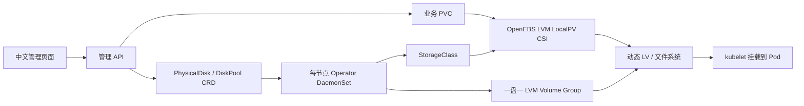

# Pulsar Operator 存储模块（DiskFleet）

本目录是统一 `pulsar-operator` 仓库的 `modules/storage/` 模块，负责物理机磁盘纳管、动态本地 PV 和中文管理控制台。使用 Python 3.10+ 标准库及原生 JavaScript；仓库根目录另包含 Pulsar Go Operator 与 React 控制台。整体构建、统一入口与部署以[仓库说明](../../README.md)为准。

**当前版本是可运行的参考实现。** 已完成离线逻辑检查及两节点真实 Kubernetes/LVM/CSI/Pulsar 验收，包括数据盘纳管、消息收发、Bookie 重建、卷扩容和 Retain。具体版本、证据与未覆盖场景见[统一验证报告](../../docs/validation.md)；大规模与节点失效恢复尚需专项验证。

## 快速体验

以下命令默认在本模块目录执行；从已取得的统一仓库进入 `modules/storage/`，无需另行下载独立 DiskFleet 项目。

```bash
cd pulsar-operator/modules/storage
python3 -m diskfleet.api
```

在能够监听端口的环境中打开 **http://127.0.0.1:8080**。模拟模式自动生成 24 台节点、144 块磁盘和示例存储池；状态与模拟卷目录保存在 `.state/`，重启后保留。目录模拟不会设置文件系统容量配额，也不会执行真实 `pvcreate`、格式化或挂载。

页面包括：总览、节点、物理盘筛选分页、批量接管计划、存储池、PVC 创建与扩容、保留数据的释放、审计和接盘指南。数据来自同源 API，页面没有把模拟数据写死在 JavaScript 中。

```bash
make test                                  # 标准库 unittest
node scripts/check-ui.cjs                   # 可选：Node 18+ 执行页面模板与转义验收
python3 scripts/inspect-disks.py            # 只读检查当前机器
python3 scripts/benchmark.py --disks 10000  # 本地元数据负载测试
kubectl kustomize deploy > /tmp/diskfleet.yaml
```

## 存储架构



本项目实现磁盘发现、审批、VG 纳管、StorageClass 生成和管理界面；动态创建 LV、绑定 PV、格式化、挂载、卸载与扩容由 **OpenEBS LVM LocalPV CSI** 完成。没有重新实现一套未经验证的 CSI 协议。

默认使用厚置备 `thinProvision: "no"`，`WaitForFirstConsumer`、`ReadWriteOnce`、`Retain` 和节点拓扑限制。只有消费 PVC 的 Pod 出现后才会绑定卷；创建 PVC 后看到 Pending 是正常状态。`fsType=ext4`，禁止缩容。普通 LVM 和本地 PV 不提供磁盘冗余或跨机器副本。

**LVM Physical Volume 与 Kubernetes PersistentVolume 是两种不同的 PV。** 原始物理盘加入 VG 后不需要挂到 `/mnt`，CSI 会在业务 LV 上创建文件系统并通过 kubelet 挂载。详见 [物理机接盘手册](docs/physical-disks.md)。

## 真实集群部署

先在独立 Linux 测试节点验证。节点须具备 LVM2、udev、device-mapper、稳定的 `/dev/disk/by-id`、独占空白测试盘，以及允许特权 DaemonSet 的策略。默认不会纳管任何节点或初始化任何磁盘。

1. 安装独立的 OpenEBS LVM CSI chart（固定版本，不安装其他 OpenEBS 引擎）：

   ```bash
   helm repo add openebs-lvm https://openebs.github.io/lvm-localpv
   helm repo update openebs-lvm
   helm upgrade --install openebs-lvm openebs-lvm/lvm-localpv \
     --namespace openebs --create-namespace --version 1.10.1
   kubectl -n openebs get pods
   kubectl get csidriver local.csi.openebs.io
   ```

   当前实测组合为 Kubernetes 1.37.2、OpenEBS LVM LocalPV chart/driver 1.10.1、Ubuntu 22.04。两节点测试还使用[固定 values](../../deploy/two-node/lvm-values.yaml)，允许 CSI 在控制平面节点运行；部署到其他环境需重新验证。若 kubelet 路径不是 `/var/lib/kubelet`，按驱动 chart 的 `lvmNode.kubeletDir` 配置。

2. 在本模块目录构建并分发存储镜像：

   ```bash
   docker build -t diskfleet:dev .
   ```

   本地 kind 可使用 `kind load docker-image diskfleet:dev`；物理机集群应推送到自己的 registry，并将本模块 `deploy/api.yaml` 和 `deploy/agent.yaml` 的 image 改为该地址或 digest。也可从仓库根目录运行 `make image-storage STORAGE_IMG=YOUR_REGISTRY/pulsar-operator-storage:dev`；构建变量只设置镜像标签，仍需同步部署清单中的 image。

3. 建立 namespace 和管理凭证，再应用部署：

   ```bash
   kubectl apply -f deploy/namespace.yaml
   python3 -c 'import secrets; print(secrets.token_urlsafe(32), end="")' | \
     kubectl -n diskfleet-system create secret generic diskfleet-api-token \
       --from-file=token=/dev/stdin
   kubectl apply -k deploy
   kubectl -n diskfleet-system rollout status deployment/diskfleet-api
   ```

   已存在的 Secret 应复用，或走自己的凭据轮换流程。API 以非 root 运行，ClusterIP 服务不直接暴露外网。集群模式要求至少 24 字符的 Bearer Token；前端凭证只保存在 sessionStorage。生产接入组织的 TLS/身份代理，限制可管理命名空间。当前 Token 是单一管理员身份，不是多租户 RBAC 系统。

4. 选择节点，只发现磁盘：

   ```bash
   kubectl label node <实际节点名> storage.diskfleet.io/enabled=true
   kubectl get physicaldisks -o wide
   kubectl -n diskfleet-system logs -l app=diskfleet-agent --tail=100
   kubectl -n diskfleet-system port-forward svc/diskfleet-api 8080:8080
   ```

   打开 http://127.0.0.1:8080 并输入 Secret 中的管理 Token。只选择核实过的空白磁盘，先生成接管计划再提交。计划有效期为 10 分钟，提交前及执行前再次核验身份。批量接管按每盘独立计划顺序执行；失败不会回滚已经建立的 VG。

5. 开启真实写入开关。**此命令会允许已提交、approved=true 的磁盘池请求开始初始化磁盘**，必须先检查所有请求：

   ```bash
   kubectl get diskpools -o yaml
   kubectl -n diskfleet-system set env daemonset/diskfleet-agent ENABLE_DISK_WRITES=true
   kubectl get diskpools -w
   ```

   Agent 只接管指定的 by-id/serial/容量组合，不支持自动擦除旧盘。系统盘、挂载盘、swap、分区、RAID 签名、holders、已有外部 PV/VG、缺失身份信息均拒绝。单盘 VG 的身份与恢复日志写入宿主 `/var/lib/diskfleet`，不得删除。该目录及 `/etc/lvm` 应纳入备份。

6. 在 Ready 存储池创建 PVC，然后创建引用该 PVC 的 Pod。可参考 `deploy/example-workload.yaml`，替换其中 StorageClass；或执行验收脚本：

   ```bash
   bash scripts/e2e-k8s.sh <实际的-diskfleet-storageclass>
   ```

   脚本创建隔离 namespace，验证真实读写、Pod 重建、扩容和 Retain；不初始化物理盘，不销毁保留的 PV。失败时保留现场。执行前阅读脚本与输出的资源清理说明。

## 大规模管理能力与边界

- 每节点一个 Operator，按 `storage.diskfleet.io/node` 标签读取本节点资源，并再次核对 spec。超过 63 字符的节点名使用标签哈希，spec 仍保存原名；StorageClass 读取真实 hostname 标签作为拓扑。磁盘操作串行加文件锁，互相独立的节点并行工作。
- Kubernetes REST 列表采用分页；调谐间隔默认 30 秒并加入随机抖动；状态没有变化时不写入 API Server。
- 管理页分页、搜索与批量计划；每盘一个 VG，避免某盘故障影响同一 VG 内其他物理盘。
- 模拟模式容量预留在 SQLite 事务内完成，并发分配不能超配。真实厚置备的物理容量以 LVM/CSI 分配结果为准，管理 API 显示值可能滞后，PVC 可能因并发耗尽而 Pending。
- **尚未证明支持数万节点。** 当前管理 API 每 30 秒缓存全量对象，单副本 SQLite 保存计划/审计，每盘一个 StorageClass；这些是扩大规模前要替换的部分。建议改为 watch 驱动索引、按机房分片、共享存储等级的 StorageClass，以及持久审计队列，并实测 API Server/etcd 负载。
- API Deployment 的状态卷当前为 `emptyDir`，Pod 重建会丢失未提交计划、API 审计和释放历史。CRD/PVC/PV 与节点磁盘日志不受影响。正式环境须将 API data 卷换成持久卷或外部数据库。API 暂不支持多副本。
- 当前只提供设备可用性/容量与操作审计；SMART、温度、介质寿命、故障率时间序列应接 Prometheus/node-exporter/smartctl-exporter。没有实现故障盘自动迁移、跨节点复制、自动 RAID 或多租户权限隔离。

## 文件与接口

与同仓库 Pulsar Operator 的跨节点 StorageClass、只读 PVC 观察、配置生成器和真实验收入口见 [Pulsar 集成说明](integrations/pulsar/README.md)。Pulsar 源码基于用户指定的 **SongOf/pulsar-operator** `3c042c5`。统一 Gateway 的 `/` 为 Pulsar 控制台，`/storage/` 为本模块控制台，两个模块各自验证访问凭证。也可直接访问本模块服务的 `/`；两种部署方式共用同一套前端文件。

| 位置 | 内容 |
|---|---|
| `diskfleet/operator.py` | 节点发现、CRD 调谐、StorageClass、安全生命周期 |
| `diskfleet/storage.py` | 磁盘安全检查、VG 接管、锁与恢复日志 |
| `diskfleet/kube.py` / `cluster.py` | TLS Kubernetes REST 客户端、真实集群管理 API |
| `diskfleet/store.py` | 模拟容量事务与本地审计/计划 |
| `diskfleet/api.py` / `static/` | HTTP API 与前端 |
| `deploy/` | CRD、RBAC、DaemonSet、Deployment、示例 |
| `tests/` | HTTP 协议、并发、恢复、安全边界与控制器测试 |

接口字段见 [CONTRACT.md](CONTRACT.md)。外部监听需配置 `API_TOKEN`，例如 `API_HOST=0.0.0.0`；默认只监听回环地址。服务应放在 TLS 代理之后，不应直接作为公网服务器使用。

## 依据

- [Kubernetes StorageClass 与 WaitForFirstConsumer](https://kubernetes.io/docs/concepts/storage/storage-classes/)
- [CSI 节点挂载与部署约束](https://kubernetes-csi.github.io/docs/deploying.html)
- [OpenEBS LVM StorageClass 参数](https://openebs.io/docs/user-guides/local-storage-user-guide/local-pv-lvm/configuration/lvm-storageclass-parameters)
- [OpenEBS 官方 Helm 仓库目录](https://openebs.github.io/openebs/)
