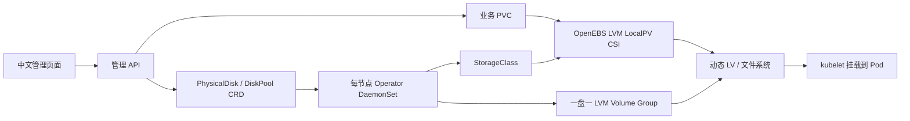

# Storage 设计与实现

本项目实现磁盘发现、审批、VG 纳管、StorageClass 生成和管理界面；动态创建 LV、绑定 PV、格式化、挂载、卸载与扩容由 **OpenEBS LVM LocalPV CSI** 完成。没有重新实现一套未经验证的 CSI 协议。

默认使用厚置备 `thinProvision: "no"`，`WaitForFirstConsumer`、`ReadWriteOnce`、`Retain` 和节点拓扑限制。只有消费 PVC 的 Pod 出现后才会绑定卷；创建 PVC 后看到 Pending 是正常状态。`fsType=ext4`，禁止缩容。普通 LVM 和本地 PV 不提供磁盘冗余或跨机器副本。

**LVM Physical Volume 与 Kubernetes PersistentVolume 是两种不同的 PV。** 原始物理盘加入 VG 后不需要挂到 `/mnt`，CSI 会在业务 LV 上创建文件系统并通过 kubelet 挂载。详见 [物理机接盘手册](physical-disks.md)。

## 容量与一致性边界

- 每节点一个 Operator，按 `storage.diskfleet.io/node` 标签读取本节点资源，并再次核对 spec。超过 63 字符的节点名使用标签哈希，spec 仍保存原名；StorageClass 读取真实 hostname 标签作为拓扑。磁盘操作串行加文件锁，互相独立的节点并行工作。
- Kubernetes REST 列表采用分页；调谐间隔默认 30 秒并加入随机抖动；状态没有变化时不写入 API Server。
- 管理页分页、搜索与批量计划；每盘一个 VG，避免某盘故障影响同一 VG 内其他物理盘。
- 模拟模式容量预留在 SQLite 事务内完成，并发分配不能超配。真实厚置备的物理容量以 LVM/CSI 分配结果为准，管理 API 显示值可能滞后，PVC 可能因并发耗尽而 Pending。
- **尚未证明支持数万节点。** 当前管理 API 每 30 秒缓存全量对象，单副本 SQLite 保存计划/审计，每盘一个 StorageClass；这些是扩大规模前要替换的部分。建议改为 watch 驱动索引、按机房分片、共享存储等级的 StorageClass，以及持久审计队列，并实测 API Server/etcd 负载。
- API 使用独立的 `diskfleet-api-state` PVC 保存计划、审计和释放记录；Deployment 固定单副本、使用 `Recreate` 更新。Pod 更换后复用同一状态卷，更新期间 API 暂时不可用。状态卷需要预先可用的基础设施 StorageClass 或静态 PV，不依赖尚待 API 初始化的 DiskFleet 池。API 暂不支持多副本。
- 当前只提供设备可用性/容量与操作审计；SMART、温度、介质寿命、故障率时间序列应接 Prometheus/node-exporter/smartctl-exporter。没有实现故障盘自动迁移、跨节点复制、自动 RAID 或多租户权限隔离。

## 实现位置与接口

与同仓库 Pulsar Operator 的跨节点 StorageClass、只读 PVC 观察、配置生成器和真实验收入口见 [Pulsar 集成说明](pulsar-integration.md)。Pulsar 源码基于用户指定的 **SongOf/pulsar-operator** `3c042c5`。统一 Gateway 的 `/` 为 Pulsar 控制台，`/storage/` 为本模块控制台，两个模块各自验证访问凭证。也可直接访问本模块服务的 `/`；两种部署方式共用同一套前端文件。

| 位置 | 内容 |
|---|---|
| `../../cmd/agent`、`../../internal/agent` | Go 节点发现、CRD 调谐、StorageClass、安全生命周期 |
| `../../api/storage/v1alpha1` | Storage / Agent 共用的 Kubernetes 资源类型与设备身份 |
| `../../internal/storage/cluster` | Kubernetes 库存、DiskPool/PVC 管理与归属校验 |
| `../../cmd/agent` 的 `--discover` | Go Agent 的只读磁盘发现入口；先运行 `make build-agent` |
| `../../internal/kubeconfig` | Agent / Storage 共用的 ServiceAccount / 显式 TLS 连接配置 |
| `../../internal/storage/store` | SQLite 模拟容量事务、本地审计/计划、释放意图 |
| `../../internal/storage/fleet` / `../../cmd/storage-plan` | 只读 Pulsar 存储规划与 CLI |
| `../../cmd/storage-api` / `../../internal/storage/httpapi` | Go HTTP 入口、路由、鉴权和参数校验 |
| `../../web/storage/static/` | 同源存储前端，通过 Go embed 编入二进制 |
| `../../config/storage/` | 存储 CRD、API RBAC/Deployment、示例 |
| `../../config/agent/` | 独立 Go Agent DaemonSet 与 RBAC |
| `../../internal/storage/**/*_test.go` | HTTP 协议、并发、恢复、规划兼容性测试 |

接口字段见 [API 契约](api.md)。外部监听需配置 `API_TOKEN`，例如 `API_HOST=0.0.0.0`；默认只监听回环地址。服务应放在 TLS 代理之后，不应直接作为公网服务器使用。
